# BAB 4 HASIL

Bab ini menyajikan hasil penyiapan dataset dan representasi eksperimen, analisis karakteristik linguistik dataset, hasil audit manual independen dua penilai (*independent dual-annotator audit*), serta rancangan dan realisasi pelaksanaan pelatihan (*fine-tuning*) model IndoBERT-large-p1 pada seluruh skenario eksperimen. Evaluasi komparatif mencakup pengujian pada data uji acuan manusia (*Gold test set*), pengujian pada tolok ukur sintetis, analisis kurva pembelajaran berbasis kesetaraan jumlah entitas (*iso-entity*), serta evaluasi daya generalisasi lintas dataset (*cross-dataset transfer*). Seluruh data hasil eksperimen disajikan secara objektif, sedangkan analisis mendalam, penafsiran perbedaan kinerja, dan kaitannya dengan penelitian terdahulu dibahas secara komprehensif pada Bab 5.

## 4.1 Dataset Penelitian dan Representasi Anotasi

### 4.1.1 Sumber dan Komposisi Dataset

Penelitian ini menggunakan enam korpus teks berbahasa Indonesia: satu korpus acuan beranotasi manusia (*Gold-standard*) yang bersumber dari NERGRIT, empat korpus sintetis yang dihasilkan melalui orkestrasi model bahasa besar (*Large Language Models* / LLM) dengan mekanisme generasi dua fase (*2-Phase Generation*), serta satu himpunan data uji tolok ukur (*benchmark*) sintetis independen. Keempat pasangan generator dan korektor (*refiner*) LLM tersebut adalah:
1. **Nemotron**: Nemotron-3 Super 120B (Generator) dan Nemotron-3 Ultra 550B (Verifikator/Korektor).
2. **Luna**: GPT-5.6 Luna (Generator) dan Gemini 3.6 Flash Medium (Verifikator/Korektor).
3. **Gemma**: Gemma 4 31B (Generator) dan Nemotron-3 Super 120B (Verifikator/Korektor).
4. **GPT-OSS**: GPT-OSS 120B (Generator) dan Nemotron-3 Nano 30B (Verifikator/Korektor).

Benchmark sintetis tambahan dibangun secara independen melalui pipeline LLM dan diperlakukan sebagai instrumen evaluasi komparatif tambahan, sehingga kedudukannya dibedakan secara tegas dari data uji utama beranotasi manusia. Komposisi volume dan peran dari masing-masing korpus sumber disajikan pada Tabel 4.1.

**Tabel 4.1 Komposisi dataset penelitian**

| Dataset | Jumlah Kalimat Sumber | Peran dalam Eksperimen |
| --- | --- | --- |
| NERGRIT (Gold) | 17.431 | Baseline acuan manusia (Gold) |
| Nemotron | 17.525 | Kondisi pelatihan sintetis utama |
| Luna | 17.427 | Kondisi pelatihan sintetis utama |
| Gemma | 17.434 | Kondisi pelatihan sintetis utama |
| GPT-OSS | 17.435 | Kondisi pelatihan sintetis utama |
| Benchmark sintetis | 1.000 | Evaluasi tolok ukur sintetis tambahan |

Selain volume kalimat akhir, karakteristik proses pembentukan data sintetis melalui mekanisme dua fase juga dimonitor secara terprogram. Parameter inferensi, volume token input-output, keterlibatan penalaran logis (*Chain-of-Thought* / CoT), serta waktu komputasi yang dihabiskan pada setiap pipeline sintetis dicatat pada Tabel 4.2.

**Tabel 4.2 Karakteristik eksekusi dan telemetri pipeline pembuatan data sintetis dua fase**

| Korpus Sintetis | Model Generator (Fase 1) | Model Verifikator (Fase 2) | Kalimat Berhasil | Token Generasi (Fase 1) | Token Koreksi (Fase 2) | Total Waktu Eksekusi |
|---|---|---|---|---|---|---|
| Nemotron | Nemotron-3 Super 120B | Nemotron-3 Ultra 550B | 17.525 | 24,33 Juta (68,2% CoT) | 4,69 Juta (56,4% CoT) | ~105,3 jam |
| Luna | GPT-5.6 Luna | Gemini 3.6 Flash Medium | 17.427 | 3,38 Juta | 3,51 Juta (Latent CoT) | ~37,5 jam |
| Gemma | Gemma 4 31B | Nemotron-3 Super 120B | 17.434 | 2,22 Juta | 6,22 Juta (70,8% CoT) | ~88,4 jam |
| GPT-OSS | GPT-OSS 120B | Nemotron-3 Nano 30B | 17.435 | 10,50 Juta | 45,07 Juta (58,7% CoT) | ~182,1 jam |

Data telemetri pada Tabel 4.2 memperlihatkan variasi pendekatan komputasi antarmodel dalam memproses anotasi:
1. **Model dengan CoT Terbuka (*Explicit Scratchpad*)**: Model seperti Nemotron-3 Super dan Nemotron-3 Nano memproduksi token penalaran CoT dalam jumlah masif yang dituliskan langsung ke dalam teks (56%–71% dari total token keluaran) guna memvalidasi batas entitas dan mengisolasi gelar terhadap nama orang sebelum mengeluarkan struktur JSON akhir.
2. **Model dengan Penalaran Laten (*Latent Native CoT*)**: Verifikator **Gemini 3.6 Flash Medium** beroperasi dengan mode penalaran terintegrasi (*thinking budget: medium*). Berbeda dengan Nemotron yang mengeksternalkan teks penalarannya, Gemini Flash memproses langkah penalaran secara internal pada representasi *hidden states* (tercatat pada metadata *reasoning tokens* terpisah tanpa mencemari teks respons), sehingga angka 3,51 Juta token pada Tabel 4.2 merepresentasikan volume token luaran JSON terstruktur bersih.
3. **Model Inferensi Langsung (*Direct Generation*)**: Model generator **GPT-5.6 Luna** (Fase 1) dan **Gemma 4 31B** (Fase 1) beroperasi murni dalam mode inferensi terarah langsung tanpa alokasi token penalaran tambahan, menghasilkan rasio token yang sangat padat (2,2M–3,4M token) dengan waktu eksekusi yang jauh lebih efisien (~37,5 jam total pada korpus Luna).

### 4.1.2 Penyesuaian Format Label dan Cakupan Kelas Entitas

Pada pemeriksaan terhadap data sumber NERGRIT, teridentifikasi sejumlah kekeliruan sintaksis penulisan kode label BIO akibat kesalahan pengetikan (*typographical errors*) pada berkas rujukan publik. Sebagai contoh:
- Kode `B-L0C` tertulis menggunakan angka nol sebagai pengganti huruf kapital `O`.
- Kode `B=CRD` menggunakan karakter sama dengan (`=`) sebagai pengganti tanda hubung (`-`).
- Kode `B-PER.` memuat tanda titik (`.`) tambahan di akhir label.

Kode-kode tersebut dipetakan secara terprogram ke format baku yang bersesuaian (`B-LOC`, `B-CRD`, dan `B-PER`) berdasarkan pemetaan label eksplisit yang terdokumentasi. Selain itu, tiga kemunculan karakter rusak (*mojibake*) pada label latar belakang `O` juga dipetakan kembali ke label `O` murni.

Secara keseluruhan, terdapat **255 penyesuaian kode sintaksis label** pada data sumber NERGRIT. Rincian penyesuaian sebelum dan sesudah koreksi disimpan secara sistematis dalam artefak data eksperimen dan diringkas pada Lampiran. Penyesuaian ini bersifat terbatas pada standardisasi kode sintaksis label BIO dan tidak mengubah keputusan substantif atas anotasi semantik entitas.

Terkait taksonomi kelas entitas, kategori **`REG`** (*Religion* pada skema asli NERGRIT) dikecualikan dari representasi eksperimen utama dan dipetakan ke label latar (`O`). Keputusan metodologis ini didasarkan pada empat temuan empiris hasil audit mendalam terhadap 454 rentang entitas `REG` (141 nilai unik) pada korpus acuan NERGRIT Gold:

1. **Cakupan Semantik yang Terlalu Luas dan Tidak Terstandarisasi (*Over-broad Scope*)**: Dari 454 rentang berlabel `REG` pada NERGRIT Gold, hanya **57 rentang (12,6%)** yang benar-benar merujuk pada nama agama atau kepercayaan resmi (seperti *Islam* [30], *Hindu* [9], *Buddha* [5], *Katolik* [5], *Kristen* [5], *Sunda Wiwitan* [2], dan *Konghucu* [1]). Sebesar **87,4% sisanya (397 rentang)** justru mencakup kosakata keagamaan heterogen yang melampaui definisi standar entitas nama agama.
2. **Tabrakan Taksonomi Sistematis (*Semantic Collision*) dan Inkonsistensi Internal Korpus**: Mayoritas rentang `REG` pada NERGRIT Gold bertumpang tindih secara langsung dengan kelas entitas aktif lainnya dan dilabeli secara kontradiktif di dalam korpus NERGRIT itu sendiri:
   - **Peristiwa Keagamaan dan Kalender (`EVT` / `DAT`) — 139 rentang (30,6%)**: Mencakup *Ramadan/Ramadhan* (60), *Idul Fitri / Hari Raya Idul Fitri* (30), *Lebaran* (26), *Waisak* (4), *Natal* (3), *Idul Adha* (3), dan *Galungan* (3). Di dalam NERGRIT Gold sendiri, entitas yang sama dilabeli secara terbelah antara `EVT` dan `REG`, seperti *Lebaran* (80 `EVT` berbanding 26 `REG`), *Hari Raya Idul Fitri* (5 `EVT` berbanding 5 `REG`), *Natal* (8 `EVT` berbanding 3 `REG`), dan *Idul Adha* (7 `EVT` berbanding 2 `REG`).
   - **Sebutan Tuhan, Tokoh, dan Gelar Keagamaan (`PER` / `TTL`) — 70 rentang (15,4%)**: Mencakup *Allah / Allah SWT* (18), *ulama* (9), *Tuhan* (7), *Ustaz/Ustad* (5), *Nabi Muhammad SAW* (3), *pendeta* (3), dan *Imam* (2), yang secara struktural beririsan dengan kelas `PER` dan `TTL`.
   - **Kelompok Demografis dan Penganut Agama (`NOR`) — 62 rentang (13,7%)**: Mencakup *Muslim* (24), *umat Islam* (11), *Yahudi* (9), *Muslim Rohingya* (6), dan *Kristiani* (3), yang bertabrakan dengan kelas `NOR` (*Nationalities, Religious, or Political Groups*).
   - **Kitab Suci dan Teks Keagamaan (`WOA`) — 28 rentang (6,2%)**: Mencakup *Alquran / Al-Qur'an* (21), *kitab tafsir Alquran* (2), *Taurat* (1), dan *hadis* (1), yang secara taksonomi beririsan dengan karya tulis pada kelas `WOA` (*Work of Art*).
   - **Tempat Ibadah dan Situs Suci (`FAC` / `LOC` / `GPE`) — 22 rentang (4,8%)**: Mencakup *masjid* (9), *surau* (5), *Gereja* (3), *musala* (3), dan *Ka'bah* (1). Pemeriksaan silang pada NERGRIT Gold menunjukkan kata *Masjid* terpecah ke dalam lima kelas berbeda sekaligus (23 `FAC`, 9 `REG`, 6 `LOC`, 4 `NOR`, dan 2 `ORG`), sementara kota suci seperti *Makkah* (7 `GPE`) dan *Madinah* (9 `GPE`, 1 `LOC`) dilabeli sebagai wilayah geopolitik/lokasi.
3. **Inklusi Ungkapan Lisan, Interjeksi Doa, dan Verba Ibadah Umum (*Non-Named Entities*) — 76 rentang (16,7%)**: Korpus NERGRIT Gold juga melabeli ungkapan lisan keagamaan (seperti *Insya Allah* [20], *Alhamdulillah* [10], *Astaghfirullah*, *Wallahualam*, dan *Laa Haula Wa Laa Quwwata Illa Billaah*) serta kata kerja atau nomina aktivitas ibadah umum (seperti *puasa* [10], *sholat/salat tarawih* [10], *Buka Puasa* [9], *azan* [4], *takjil*, *doa*, *berzikir*, *misa*, dan *sembahyang*) sebagai entitas `REG`. Secara linguistik, ekspresi interjeksi dan verba umum tersebut bukan merupakan frasa nomina penunjuk entitas bernama (*proper noun*).
4. **Penyelarasan dengan Standar Internasional OntoNotes 5.0**: Standar internasional **OntoNotes 5.0** (18 kelas entitas) tidak mendefinisikan kelas tunggal `RELIGION`, melainkan mendistribusikan entitas terkait keagamaan secara terstruktur ke dalam kelas `NORP` (kelompok umat pada `NOR`), `EVENT` (hari besar keagamaan pada `EVT`), `WORK_OF_ART` (kitab suci pada `WOA`), dan `FAC` (bangunan tempat ibadah). Mempertahankan label `REG` yang tumpang tindih tersebut akan menimbulkan penalti *false negative* dan *false positive* semu lintas kelas saat model memprediksi label yang secara semantik benar (misalnya memprediksi *Idul Fitri* sebagai `EVT` atau *Masjid* sebagai `FAC`).

Label `REG` serta label gelar `TTL` (*Title*) tetap dipertahankan pada anotasi sumber, namun dipetakan ke dalam label latar (`O`) pada representasi pelatihan dan evaluasi model. Token yang dipetakan ke label O ini tetap disupervisi sebagai kelas negatif (bukan diabaikan dengan indeks semu `-100`), sehingga model terlatih untuk membedakan antara entitas inti dengan kata-kata penjelas atau gelar. Kategori angka kardinal (`CRD`) dan kuantitas berukuran (`QTY`) tetap dipisahkan sebagai dua kelas independen. Dengan demikian, eksperimen utama menggunakan **18 kelas entitas aktif** yang direpresentasikan ke dalam **37 tag BIO baku** (1 label `O` dan 36 pasangan `B-` serta `I-`).

### 4.1.3 Pembagian Data dan Hasil Pemeriksaan Kebocoran

Untuk menjamin perbandingan performa yang objektif dan adil, seluruh kalimat dari keenam korpus dikelompokkan secara global sebelum dilakukan penempatan partisi latih (*train*), validasi (*validation*), dan uji (*test*). Kalimat yang identik atau memiliki tingkat kemiripan tekstual yang sangat tinggi (diukur menggunakan koefisien *Jaccard similarity* karakter 5-gram dengan nilai ambang $\ge 0,90$ pada kalimat dengan panjang minimal 10 token) diisolasi ke dalam satu kelompok (*equivalence group*).

Setiap kelompok kalimat tersebut kemudian ditempatkan secara utuh ke dalam satu partisi dengan urutan prioritas: kelompok yang memuat kalimat uji dialokasikan ke partisi *test*, kelompok yang memuat kalimat validasi dialokasikan ke *validation*, dan sisanya dialokasikan ke partisi *train*. Strategi ini menjamin tidak ada kalimat yang sama atau sangat mirip yang terdistribusi ganda di antara partisi latih dan partisi evaluasi. Kelompok data sintetis yang tidak terikat dengan data uji dialokasikan ke dalam rasio 85% latih dan 15% validasi menggunakan *random seed* 42.

Hasil pembagian partisi setelah prosedur pengelompokan ulang disajikan pada Tabel 4.3.

**Tabel 4.3 Jumlah record pada partisi data hasil pengelompokan ulang**

| Dataset | Latih (Train) | Validasi (Validation) | Uji (Test) | Berpindah Partisi | Total Record |
| --- | --- | --- | --- | --- | --- |
| NERGRIT (Gold) | 12.465 | 2.543 | 2.423 | 64 | 17.431 |
| Nemotron | 14.896 | 2.629 | 0 | 4.468 | 17.525 |
| Luna | 14.813 | 2.614 | 0 | 4.439 | 17.427 |
| Gemma | 14.819 | 2.615 | 0 | 4.571 | 17.434 |
| GPT-OSS | 14.820 | 2.615 | 0 | 4.439 | 17.435 |
| Benchmark sintetis | 0 | 0 | 1.000 | 0 | 1.000 |

Berdasarkan hasil pemeriksaan integritas partisi, tercatat **0 kelompok kalimat** yang melintasi batas partisi. Dengan demikian, partisi uji beranotasi manusia (*Gold test*) dan tolok ukur sintetis terbukti bersih dari kebocoran teks terhadap data latih dalam cakupan pengujian kesamaan n-gram tersebut. Seluruh integritas representasi data diproteksi menggunakan *cryptographic checksum* (SHA-256) guna memastikan keterulangan eksperimen yang konsisten.

## 4.2 Analisis Karakteristik Dataset

### 4.2.1 Jumlah Kalimat, Token, dan Entitas

Tabel 4.4 menyajikan statistik deskriptif dari keenam korpus pada skema representasi 18 kelas entitas. Penghitungan token didasarkan pada token kata sumber sebelum pemecahan subword oleh WordPiece tokenizer IndoBERT. Rentang entitas multi-kata (*multi-token span*) dihitung sebagai satu kesatuan entitas.

**Tabel 4.4 Statistik deskriptif seluruh korpus pada skema representasi 18 kelas**

| Dataset | Jumlah Kalimat (S) | Jumlah Token (T) | Rentang Entitas (E) | Token Berentitas |
| --- | --- | --- | --- | --- |
| NERGRIT (Gold) | 17.431 | 435.459 | 59.994 | 131.153 |
| Nemotron | 17.525 | 545.800 | 112.411 | 271.914 |
| Luna | 17.427 | 445.812 | 91.006 | 209.918 |
| Gemma | 17.434 | 353.524 | 65.563 | 134.306 |
| GPT-OSS | 17.435 | 531.206 | 100.236 | 257.023 |
| Benchmark sintetis | 1.000 | 31.324 | 6.426 | 16.297 |

### 4.2.2 Panjang Kalimat dan Kepadatan Entitas

Untuk membedah struktur gramatikal dan kepadatan entitas antardataset, diterapkan pengukuran deskriptif berbasis Persamaan 4.1 hingga Persamaan 4.5:

$$
\overline{L} = \frac{T}{S} \qquad (4.1)
$$

$$
\overline{E} = \frac{E}{S} \qquad (4.2)
$$

$$
D_{\text{token}} = \frac{T_e}{T} \times 100\text{ % } \qquad (4.3)
$$

$$
D_{\text{span}} = \frac{E}{T} \times 100 \qquad (4.4)
$$

$$
P_c = \frac{E_c}{E} \times 100\text{ % } \qquad (4.5)
$$

di mana:
- $\overline{L}$: Rata-rata jumlah token per kalimat.
- $\overline{E}$: Rata-rata jumlah rentang entitas per kalimat.
- $D_{token}$: Kepadatan token berentitas (persentase token teks yang menjadi bagian dari suatu entitas bernama).
- $D_{span}$: Kepadatan rentang entitas per 100 token teks.
- $P_c$: Proporsi kemunculan entitas dari kelas $c$ terhadap total rentang entitas aktif.

Rincian karakteristik pada partisi pelatihan (*training set*) yang digunakan dalam eksperimen *fine-tuning* disajikan pada Tabel 4.5.

**Tabel 4.5 Karakteristik partisi pelatihan model IndoBERT**

| Dataset | Kalimat (S) | Token (T) | Entitas (E) | Token/Kalimat | Entitas/Kalimat | Kepadatan Token (%) | Entitas per 100 Token |
| --- | --- | --- | --- | --- | --- | --- | --- |
| NERGRIT (Gold) | 12.465 | 308.230 | 42.614 | 24,73 | 3,42 | 30,67 | 13,83 |
| Nemotron | 14.896 | 463.142 | 95.491 | 31,09 | 6,41 | 49,85 | 20,62 |
| Luna | 14.813 | 378.810 | 77.286 | 25,57 | 5,22 | 47,02 | 20,40 |
| Gemma | 14.819 | 300.878 | 55.775 | 20,30 | 3,76 | 37,98 | 18,54 |
| GPT-OSS | 14.820 | 451.884 | 85.358 | 30,49 | 5,76 | 48,39 | 18,89 |

Tabel 4.5 memperlihatkan perbedaan karakteristik yang nyata antara data acuan manusia dan data sintetis LLM. Korpus Nemotron dan GPT-OSS memiliki rata-rata panjang kalimat yang lebih panjang (~30–31 token/kalimat) dan kepadatan entitas yang sangat tinggi (~5,7–6,4 entitas/kalimat), dengan hampir setengah dari seluruh token teksnya ($D_{token} \approx 48\% - 50\%$) merupakan bagian dari entitas bernama. Sebaliknya, korpus acuan manusia (NERGRIT Gold) memiliki kepadatan entitas yang lebih rendah ($D_{token} = 30,67\%$) dengan rata-rata 3,42 entitas per kalimat.

Distribusi kumulatif panjang kalimat dan jumlah entitas antar-korpus ditampilkan secara visual pada Gambar 4.1.

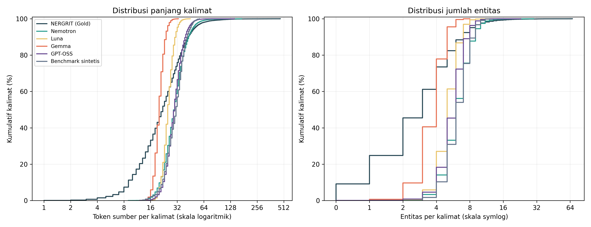

**Gambar 4.1 Distribusi panjang kalimat dan jumlah entitas pada seluruh korpus penelitian**

### 4.2.3 Distribusi Kelas Entitas

Tabel 4.6 merinci frekuensi kemunculan rentang entitas untuk masing-masing dari 18 kelas pada seluruh korpus, sedangkan proporsi relatifnya diilustrasikan pada Gambar 4.2.

**Tabel 4.6 Frekuensi kemunculan kelas entitas pada seluruh korpus**

| Kelas Entitas | NERGRIT (Gold) | Nemotron | Luna | Gemma | GPT-OSS | Benchmark sintetis |
| --- | --- | --- | --- | --- | --- | --- |
| CRD | 5.617 | 2.149 | 4.757 | 1.819 | 1.570 | 273 |
| DAT | 5.232 | 23.068 | 8.659 | 5.017 | 14.265 | 1.673 |
| EVT | 1.788 | 5.877 | 4.125 | 2.447 | 4.697 | 250 |
| FAC | 624 | 6.387 | 4.421 | 3.659 | 5.948 | 502 |
| GPE | 9.115 | 15.927 | 19.715 | 12.712 | 14.603 | 999 |
| LAN | 13 | 1.161 | 1.694 | 1.086 | 1.817 | 66 |
| LAW | 445 | 2.979 | 1.313 | 2.264 | 2.332 | 152 |
| LOC | 3.500 | 2.216 | 2.253 | 2.220 | 2.718 | 112 |
| MON | 1.719 | 5.662 | 3.899 | 2.873 | 4.353 | 235 |
| NOR | 5.651 | 1.841 | 1.998 | 1.633 | 1.688 | 34 |
| ORD | 817 | 1.254 | 928 | 1.173 | 1.082 | 38 |
| ORG | 5.608 | 16.698 | 15.479 | 11.529 | 17.307 | 839 |
| PER | 9.544 | 9.637 | 9.537 | 6.734 | 9.066 | 213 |
| PRC | 1.139 | 2.812 | 2.694 | 2.032 | 3.490 | 157 |
| PRD | 5.833 | 4.230 | 3.304 | 3.242 | 5.520 | 228 |
| QTY | 2.081 | 5.296 | 3.794 | 2.943 | 6.175 | 172 |
| TIM | 1.060 | 2.916 | 1.982 | 1.839 | 1.935 | 361 |
| WOA | 208 | 2.301 | 454 | 341 | 1.670 | 122 |

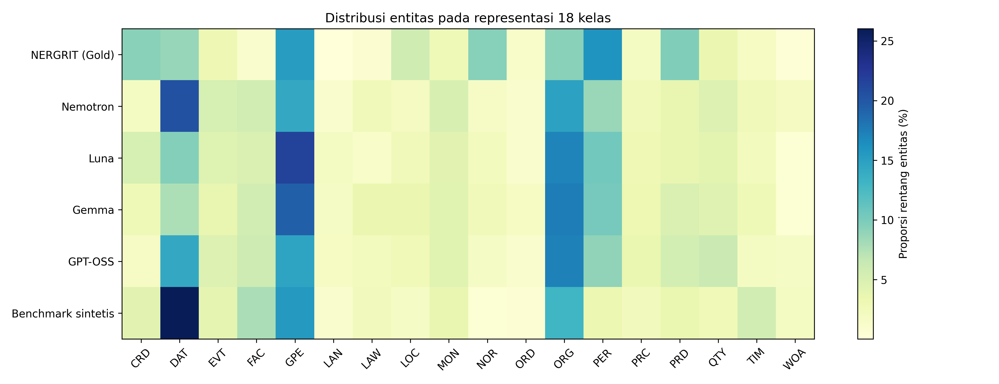

**Gambar 4.2 Visualisasi proporsi distribusi 18 kelas entitas pada seluruh korpus**

Sebagai pelengkap transparansi data atas alasan eksklusi kelas `REG` yang telah diuraikan pada Subbab 4.1.2, rincian proporsi semantik dari 454 rentang entitas `REG` pada korpus sumber NERGRIT (Gold) sebelum dipetakan ke label latar `O` dirangkum pada Tabel 4.7.

**Tabel 4.7 Rincian distribusi semantik rentang entitas REG pada korpus sumber NERGRIT (Gold) sebelum pemetaan ke label O**

| Kategori Semantik dalam Label REG (NERGRIT Gold) | Jumlah Rentang | Proporsi | Contoh Entitas pada Korpus Sumber | Kelas Aktif yang Beririsan / Status |
| --- | --- | --- | --- | --- |
| Peristiwa Keagamaan & Hari Raya | 139 | 30,62% | Ramadan (60), Idul Fitri (30), Lebaran (26), Waisak (4), Natal (3) | Bertabrakan dengan EVT & DAT |
| Ungkapan Lisan, Doa, & Verba Ibadah Umum | 76 | 16,74% | Insya Allah (20), puasa (10), Alhamdulillah (10), salat tarawih (10) | Non-entitas bernama (interjeksi/verba umum) |
| Sebutan Tuhan, Tokoh, & Gelar Keagamaan | 70 | 15,42% | Allah SWT (18), ulama (9), Tuhan (7), Ustaz (5), Nabi Muhammad SAW (3) | Bertabrakan dengan PER & TTL |
| Kelompok Demografis & Penganut Agama | 62 | 13,66% | Muslim (24), umat Islam (11), Yahudi (9), Muslim Rohingya (6) | Bertabrakan dengan NOR |
| Nama Agama & Kepercayaan Resmi | 57 | 12,56% | Islam (30), Hindu (9), Buddha (5), Katolik (5), Kristen (5), Konghucu (1) | Inti nama agama murni |
| Kitab Suci & Teks Keagamaan | 28 | 6,17% | Al-Qur'an (21), kitab tafsir Alquran (2), Taurat (1), hadis (1) | Bertabrakan dengan WOA |
| Tempat Ibadah & Situs Suci | 22 | 4,85% | masjid (9), surau (5), Gereja (3), musala (3), Ka'bah (1) | Bertabrakan dengan FAC, LOC, & GPE |
| Total Rentang REG (141 Nilai Unik) | 454 | 100,00% | Seluruh rentang REG pada NERGRIT Gold | Dipetakan ke label latar (O) |

### 4.2.4 Karakteristik Pengulangan dan Anotasi

Penelitian ini menerapkan kebijakan untuk mempertahankan seluruh record sumber tanpa pembersihan paksa, sehingga sifat alami korpus (termasuk kalimat berulang dan variasi anotasi) dapat dianalisis secara transparan. Ringkasan karakteristik pengulangan teks dan anomali anotasi sumber disajikan pada Tabel 4.8.

**Tabel 4.8 Karakteristik pengulangan dan anomali anotasi sumber yang dipertahankan**

| Dataset | Teks Unik | Record Pengulangan | Kelompok Konflik Anotasi | Transisi BIO Anomali | Token Kosong |
| --- | --- | --- | --- | --- | --- |
| NERGRIT (Gold) | 16.764 | 667 | 49 | 250 | 6 |
| Nemotron | 17.459 | 66 | 21 | 0 | 0 |
| Luna | 17.274 | 153 | 41 | 0 | 0 |
| Gemma | 15.977 | 1.457 | 317 | 0 | 0 |
| GPT-OSS | 14.172 | 3.263 | 788 | 0 | 0 |
| Benchmark sintetis | 989 | 11 | 7 | 0 | 0 |

Tabel 4.8 menunjukkan bahwa korpus NERGRIT Gold memiliki 250 transisi BIO yang tidak konsisten (tag `I-` yang muncul tanpa didahului oleh tag `B-` yang sesuai) serta 6 token kosong bawaan dari data aslinya. Sementara itu, keempat korpus sintetis yang dihasilkan melalui pipeline generasi dua fase memiliki transisi BIO yang 100% konsisten berkat modul validasi sintaksis CoNLL pada pipeline pembuatan data.

## 4.3 Hasil Pemeriksaan Manual Anotasi

### 4.3.1 Pelaksanaan, Sampel Audit, dan Reliabilitas Antarpenilai (IAA)

Pemeriksaan manual terhadap kualitas anotasi (*human annotation audit*) dilaksanakan secara mandiri (*blind* dan independen) oleh dua penilai, yaitu **Arif Athaya Harahap** (Penilai A1) dan **Muhammad Faiz Fauzan** (Penilai A2) pada tanggal **22 Oktober 2026**. Berbeda dengan korpus acuan manusia (NERGRIT) yang dievaluasi sebagai data sekunder, audit anotasi manusia ini difokuskan secara khusus untuk mengevaluasi mutu anotasi intrinsik pada **keempat korpus sintetis hasil generasi LLM** (`Nemotron`, `Luna`, `Gemma`, dan `GPT-OSS`).

Sampel audit diambil secara acak berstrata (*stratified random sampling*) tanpa pengembalian (*without replacement*) dengan nilai *seed* acak tetap `20261022`. Stratifikasi dibentuk berdasarkan persilangan antara jumlah entitas dalam kalimat (kelompok 0 entitas, 1 entitas, dan $\ge 2$ entitas) dengan panjang kalimat relatif terhadap nilai median populasi masing-masing korpus. Dari masing-masing keempat korpus sintetis diambil tepat 100 kalimat representatif, sehingga total sampel audit mencakup **400 kalimat** (**10.812 token**, mencakup **800 lembar evaluasi independen**).

Kedua penilai melakukan evaluasi secara terpisah tanpa saling berkomunikasi. Reliabilitas antarpenilai diuji menggunakan koefisien kesepakatan Cohen's Kappa ($\kappa$) pada tingkat token (37 tag BIO dan 18 kelas + O) serta tingkat keputusan entitas (*KEEP* / *REMOVE* / *REPLACE* dan *CORRECT* / *INCORRECT*), dilengkapi dengan *Pairwise Exact Span-$F_1$ Agreement* dan selang kepercayaan *bootstrap* 95% (1.000 iterasi). Rangkuman hasil pengujian reliabilitas IAA gabungan pada 400 kalimat sintetis disajikan pada Tabel 4.9a, sedangkan rincian per dataset sintetis disajikan pada Tabel 4.9b.

**Tabel 4.9a Hasil pengujian reliabilitas antarpenilai independen (*Inter-Annotator Agreement*) pada 400 sampel kalimat sintetis**

| Metrik Kesepakatan Antarpenilai | Nilai Empiris | 95% Bootstrap CI | Interpretasi (Landis & Koch, 1977) |
| :--- | :---: | :---: | :--- |
| Token Cohen's $\kappa$ (37 tag BIO) | **0,987** | [0,983 – 0,991] | Kesepakatan Hampir Sempurna (*Almost Perfect*) |
| Token Cohen's $\kappa$ (18 kelas + O) | **0,989** | [0,985 – 0,993] | Kesepakatan Hampir Sempurna (*Almost Perfect*) |
| Entity-Decision $\kappa$ (KEEP / REMOVE / REPLACE) | **0,923** | [0,895 – 0,947] | Kesepakatan Hampir Sempurna (*Almost Perfect*) |
| Entity-Decision $\kappa$ (CORRECT / INCORRECT) | **0,928** | [0,899 – 0,952] | Kesepakatan Hampir Sempurna (*Almost Perfect*) |
| Pairwise Exact Span-$F_1$ Agreement | **97,63%** | [96,84% – 98,34%] | Konsistensi Batas Rentang Sangat Tinggi (1.975 sepakat) |
| Persentase Kesepakatan Token (BIO) | **99,13%** | — | 10.718 dari 10.812 token berlabel BIO identik |
| Tingkat Kalimat Identik (*Zero Disagreement*) | **89,75%** | — | 359 dari 400 kalimat disepakati 100% tanpa selisih |

**Tabel 4.9b Populasi asal, sampel audit, dan rincian reliabilitas antarpenilai (IAA) per korpus sintetis**

| Dataset Sintetis | Jumlah Populasi Asal | Sampel Diperiksa | Token Sampel | $\kappa$ Token BIO | $\kappa$ Token Kelas | $\kappa$ Keputusan Entitas | Span-$F_1$ IAA | Kalimat Identik |
| :--- | :---: | :---: | :---: | :---: | :---: | :---: | :---: | :---: |
| Nemotron | 17.439 | 100 kalimat | 3.245 | 0,977 | 0,981 | 0,886 | 95,93% | 82,00% |
| Luna | 17.236 | 100 kalimat | 2.537 | 0,992 | 0,992 | 0,911 | 98,46% | 92,00% |
| Gemma | 15.666 | 100 kalimat | 2.029 | 0,988 | 0,989 | 0,927 | 97,60% | 92,00% |
| GPT-OSS | 13.384 | 100 kalimat | 3.001 | 0,994 | 0,995 | 0,965 | 98,72% | 93,00% |
| **Total / Agregat** | **63.725** | **400 kalimat** | **10.812** | **0,987** | **0,989** | **0,923** | **97,63%** | **89,75%** |

### 4.3.2 Hasil Pemeriksaan per Dataset

Kualitas anotasi bawaan pada masing-masing korpus sintetis dievaluasi terhadap label rujukan konsensus *dual-agreement*. Dalam skema ini, entitas dinilai **Benar** ($TP$) apabila batas awal token, batas akhir token, serta label kelas entitasnya bersesuaian persis dengan konsensus kedua penilai. Entitas dinilai **Salah** ($FP$) apabila rentang anotasi awal dibatalkan oleh konsensus penilai karena kekeliruan batas rentang kata (*boundary error*), kesalahan klasifikasi kelas, atau penandaan berlebih (*false positive*). Entitas dinilai **Terlewat** (*Missed*) apabila terdapat entitas bernama nyata dalam teks yang belum terlabeli pada anotasi awal korpus.

Hasil pemeriksaan anotasi manual beserta metrik kesesuaian anotasi (*Precision*, *Recall*, dan *F1-Score*) per korpus sintetis disajikan pada Tabel 4.10.

**Tabel 4.10 Hasil pemeriksaan manual kualitas anotasi terhadap konsensus dual-agreement pada sampel 100 kalimat per korpus sintetis**

| Dataset Sintetis | Kalimat | Benar ($TP$) | Salah ($FP$) | Terlewat (*Missed*) | $FN$ Total | Presisi Anotasi | Recall Anotasi | F1 Anotasi | Kalimat Bermasalah | Estimasi Galat Terbobot ($\widehat{p}_{error}$) |
| :--- | :---: | :---: | :---: | :---: | :---: | :---: | :---: | :---: | :---: | :---: |
| Nemotron | 100 | 517 | 118 | 21 | 83 | 81,42% | 86,17% | **83,72%** | 73 | 72,93% |
| Luna | 100 | 493 | 27 | 12 | 25 | 94,81% | 95,17% | **94,99%** | 28 | 28,05% |
| Gemma | 100 | 297 | 78 | 14 | 57 | 79,20% | 83,90% | **81,48%** | 62 | 61,43% |
| GPT-OSS | 100 | 451 | 97 | 36 | 93 | 82,30% | 82,90% | **82,60%** | 75 | 74,78% |
| **Total Gabungan** | **400** | **1.758** | **320** | **83** | **258** | **84,60%** | **87,20%** | **85,88%** | **238** | — |

Metrik kesesuaian kualitas anotasi dihitung menggunakan Persamaan 4.6 sampai Persamaan 4.8 dengan memperlakukan anotasi awal korpus sebagai prediksi dan konsensus *dual-agreement* sebagai *ground-truth*:

$$P_{audit} = \frac{TP}{TP + FP} \tag{4.6}$$

$$R_{audit} = \frac{TP}{TP + FN} \tag{4.7}$$

$$F_{1, audit} = \frac{2 P_{audit} R_{audit}}{P_{audit} + R_{audit}} \tag{4.8}$$

Berdasarkan formulasi tersebut pada gabungan 400 sampel kalimat sintetis, diperoleh nilai $TP = 1.758$, $FP = 320$, dan $FN = 258$. Nilai $FN$ (258) lebih besar daripada jumlah entitas terlewat literal (83) karena koreksi atas entitas yang salah kelas atau salah batas rentangnya memunculkan rentang acuan baru yang harus dipenuhi dalam konsensus. Secara agregat pada 400 kalimat sintetis, anotasi bawaan menghasilkan **presisi 84,60%, recall 87,20%, dan F1-score 85,88%**, dengan 238 kalimat (59,50%) memuat setidaknya satu deviasi anotasi.

Dari keempat korpus sintetis yang diuji, **Luna** (`GPT-5.6 Luna` + `Gemini 3.6 Flash Medium`) menunjukkan mutu anotasi tertinggi secara mutlak dengan raihan **$F_1 = \mathbf{94,99\%}$** (Presisi 94,81%, Recall 95,17%), serta hanya mencatatkan 28 kalimat bermasalah dari 100 sampel (estimasi galat terbobot $\widehat{p}_{error} = 28,05\%$). Posisi berikutnya diraih oleh **Nemotron** ($F_1 = 83,72\%$), **GPT-OSS** ($F_1 = 82,60\%$), dan **Gemma** ($F_1 = 81,48\%$). Tingginya capaian Luna mencerminkan keunggulan penalaran laten (*latent reasoning*) pada model verifikator Gemini Flash dalam memisahkan entitas kata benda umum (*false positives*) dan menegakkan pemisahan gelar kehormatan (`TTL`) dari nama individu (`PER`). Perlu ditekankan bahwa data audit ini berfungsi murni sebagai instrumen evaluasi independen dan **tidak digunakan untuk mengubah label data latih model**, sehingga integritas korpus hasil generasi tetap terjaga secara murni.

### 4.3.3 Hasil Pemeriksaan per Kelas

Rangkuman keputusan pemeriksaan anotasi dan reliabilitas antarpenilai menurut 18 kelas entitas pada gabungan 400 sampel kalimat sintetis disajikan pada Tabel 4.11.

**Tabel 4.11 Ringkasan kualitas anotasi dan reliabilitas IAA menurut 18 kelas entitas pada gabungan 400 sampel kalimat sintetis**

| Kelas Entitas | Entitas Benar ($TP$) | Entitas Salah ($FP$) | Entitas Terlewat (*Missed*) | $FN$ Total | Presisi (%) | Recall (%) | F1-Score (%) | Span-$F_1$ IAA (%) |
| :--- | :---: | :---: | :---: | :---: | :---: | :---: | :---: | :---: |
| CRD | 56 | 2 | 11 | 34 | 96,55% | 62,22% | 75,68% | 96,17% |
| DAT | 235 | 42 | 16 | 56 | 84,84% | 80,76% | 82,75% | 95,71% |
| EVT | 74 | 29 | 1 | 6 | 71,84% | 92,50% | 80,87% | 92,99% |
| FAC | 81 | 19 | 0 | 9 | 81,00% | 90,00% | 85,26% | 98,31% |
| GPE | 335 | 19 | 6 | 13 | 94,63% | 96,26% | 95,44% | 99,42% |
| LAN | 24 | 0 | 6 | 6 | 100,00% | 80,00% | 88,89% | 100,00% |
| LAW | 29 | 22 | 2 | 15 | 56,86% | 65,91% | 61,05% | 93,33% |
| LOC | 53 | 6 | 11 | 24 | 89,83% | 68,83% | 77,94% | 96,25% |
| MON | 97 | 2 | 0 | 1 | 97,98% | 98,98% | 98,48% | 100,00% |
| NOR | 35 | 4 | 12 | 14 | 89,74% | 71,43% | 79,55% | 98,00% |
| ORD | 17 | 8 | 5 | 6 | 68,00% | 73,91% | 70,83% | 93,33% |
| ORG | 313 | 31 | 8 | 23 | 90,99% | 93,15% | 92,06% | 99,26% |
| PER | 178 | 1 | 2 | 2 | 99,44% | 98,89% | 99,16% | 99,44% |
| PRC | 64 | 1 | 2 | 4 | 98,46% | 94,12% | 96,24% | 100,00% |
| PRD | 50 | 62 | 0 | 13 | 44,64% | 79,37% | 57,14% | 95,31% |
| QTY | 79 | 27 | 0 | 6 | 74,53% | 92,94% | 82,72% | 93,64% |
| TIM | 20 | 34 | 1 | 20 | 37,04% | 50,00% | 42,55% | 96,30% |
| WOA | 18 | 11 | 0 | 6 | 62,07% | 75,00% | 67,92% | 95,65% |
| **Total** | **1.758** | **320** | **83** | **258** | **84,60%** | **87,20%** | **85,88%** | **97,63%** |

Rincian tabulasi per kelas untuk masing-masing dataset sintetis tersedia pada Lampiran Audit Anotasi. Kelas-kelas dengan konsistensi anotasi tertinggi meliputi `PER` ($F_1 = 99,16\%$, Presisi 99,44%), `MON` ($F_1 = 98,48\%$), `PRC` ($F_1 = 96,24\%$), `GPE` ($F_1 = 95,44\%$), dan `ORG` ($F_1 = 92,06\%$). Pada kelas `NOR` ($F_1 = 79,55\%$, Presisi 89,74%), korpus **Luna, Gemma, dan GPT-OSS** mencatatkan **0 kesalahan positif palsu (`FP = 0`, Presisi 100,00%)**, sedangkan 4 kesalahan pada `NOR` seluruhnya berasal dari korpus **Nemotron** (akibat pelabelan partai politik atau ormas seperti *Partai Golkar* dan *Muhammadiyah* sebagai `NOR` alih-alih `ORG`).

Sebaliknya, kelas yang memiliki tingkat kekeliruan relatif lebih tinggi adalah `PRD` (62 salah, umumnya akibat pelabelan kata benda komoditas umum), `DAT` (42 salah) dan `TIM` (34 salah, akibat inklusi preposisi waktu seperti *'pada pukul'* atau *'hari'*), serta `ORG` (31 salah, umumnya pada kata benda administratif umum seperti *'Pemerintah'* atau *'UMKM'* yang berdiri sendiri tanpa nama entitas spesifik).

## 4.4 Hasil Pelaksanaan Pelatihan

### 4.4.1 Lingkungan dan Konfigurasi Eksperimen

Seluruh proses pelatihan *fine-tuning* model bahasa dilakukan pada infrastruktur komputasi berbasis awan menggunakan akselerator grafis tingkat pusat data **NVIDIA A100-SXM4 Tensor Core GPU**. Konfigurasi hiperparameter pelatihan ditetapkan seragam untuk seluruh kondisi eksperimen guna menjamin keterbandingan hasil yang adil (*controlled experiment*). Penetapan nilai hiperparameter ini mengadopsi rekomendasi baku dari perilis resmi model IndoBERT (Wilie dkk., 2020), tolok ukur klasifikasi token korpus NERGRIT versi multi-kelas oleh NusaCrowd (Cahyawijaya dkk., 2023), serta kaidah stabilitas pelatihan arsitektur BERT-Large (Devlin dkk., 2019; Mosbach dkk., 2021). Rincian spesifikasi konfigurasi bersama pelatihan dirangkum pada Tabel 4.12.

**Tabel 4.12 Spesifikasi konfigurasi bersama pelatihan model IndoBERT-large-p1**

| Parameter Pelatihan | Nilai Konfigurasi | Keterangan & Rasionalisasi |
|---|---|---|
| Model Fondasi (*Backbone*) | `indobenchmark/indobert-large-p1` | 24 layer, hidden size 1024, 340M parameter (Wilie dkk., 2020) |
| Profil Eksekusi Komputasi | `a100-bf16-b32-v2` | Mixed precision BF16, master weights FP32 |
| Laju Pembelajaran (*Learning Rate*) | $2 \times 10^{-5}$ | Nilai baku optimal dan stabil untuk BERT-Large (Devlin dkk., 2019; Mosbach dkk., 2021) |
| Algoritme Pengoptimal (*Optimizer*) | AdamW ($\beta_1=0,9; \beta_2=0,999; \varepsilon=10^{-8}$) | Pembobotan gradien adaptif dengan weight decay 0,01 |
| Kebijakan Penjadwal (*Scheduler*) | Linear warmup (rasio 10%) | Transisi laju pembelajaran bertahap |
| Ukuran Batch Latih (*Train Batch*) | Microbatch 32 (Akumulasi 1) | Batch efektif 32 token sekuens |
| Ukuran Batch Evaluasi (*Eval Batch*) | 64 | Akselerasi evaluasi validasi per epoch |
| Panjang Sekuens Maksimum | 256 subword (termasuk token khusus) | Chunking batas kata lossless tanpa pemotongan |
| Batas Maksimum Epoch | 10 Epochs | Batas atas iterasi pelatihan |
| Mekanisme Penghentian Dini | *Early Stopping* (patience = 2) | Pemantauan Macro-F1 validasi 18 kelas |
| Strategi Pemilihan Model Terbaik | *Load Best Model at End* = True | Checkpoint validasi Macro-F1 tertinggi |
| Nilai Pengacakan (*Random Seeds*) | 42, 123, 2026 | Tiga pengulangan independen untuk estimasi reliabilitas |
| Kontrol Presisi & Memori | Mixed Precision BF16, TF32 Nonaktif | Mengoptimalkan throughput Tensor Core A100 |

#### 4.4.1.1 Eksperimen Penentuan dan Optimasi Laju Pembelajaran (*Learning Rate*)

Guna memberikan justifikasi empiris atas pemilihan parameter pelatihan serta memastikan stabilitas konvergensi model IndoBERT-Large-p1 (340 juta parameter), dilakukan eksperimen optimasi hiperparameter (*hyperparameter search*) terfokus pada laju pembelajaran (*learning rate*). Pengujian mengevaluasi empat kandidat laju pembelajaran yang direkomendasikan pada studi kestabilan fine-tuning transformer skala besar (Devlin dkk., 2019; Mosbach dkk., 2021) dan tolok ukur NLP Indonesia (Wilie dkk., 2020; Cahyawijaya dkk., 2023), yaitu $1 \times 10^{-5}$, $2 \times 10^{-5}$, $3 \times 10^{-5}$, dan $5 \times 10^{-5}$.

Untuk mencegah kebocoran data (*zero test-set leakage*), seluruh proses penalaan dilakukan secara ketat hanya pada subset validasi (*validation split*) dari dua korpus acuan: korpus manusia **NERGRIT Gold** (12.465 kalimat latih, 2.543 validasi) sebagai *anchor baseline* dan korpus sintetis **Nemotron** (14.896 kalimat latih, 2.629 validasi) sebagai perwakilan data terdistilasi LLM. Seluruh parameter komputasi lainnya dikontrol seragam (optimizer AdamW dengan weight decay 0,01, penjadwal *linear warmup* 10%, ukuran batch efektif 32, presisi BF16, dan *early stopping* dengan *patience* 2).

Hasil pengujian performa validasi pada seluruh variasi laju pembelajaran disajikan pada Tabel 4.12a.

**Tabel 4.12a Hasil eksperimen optimasi laju pembelajaran (*learning rate*) pada data validasi**

| Dataset | Laju Pembelajaran ($lr$) | Macro-F1 Validasi | Micro-F1 Validasi | Loss Validasi | Epoch Terbaik | Karakteristik Konvergensi |
| :--- | :---: | :---: | :---: | :---: | :---: | :--- |
| NERGRIT Gold | $1 \times 10^{-5}$ | 75,49% | 84,13% | 0,2310 | 10,0 | Konvergen lambat (mencapai batas 10 epoch) |
| NERGRIT Gold | **$2 \times 10^{-5}$** | **75,38%** | **84,16%** | **0,2019** | **4,0** | **Pareto-Optimal** (Loss terendah & Micro-F1 puncak) |
| NERGRIT Gold | $3 \times 10^{-5}$ | 75,57% | 84,11% | 0,2547 | 6,0 | Stabil, namun loss validasi naik (+26,2%) |
| NERGRIT Gold | $5 \times 10^{-5}$ | 74,99% | 83,38% | 0,1959 | 3,0 | Instabilitas gradien (*overshooting*) |
| Nemotron | $1 \times 10^{-5}$ | 78,98% | 84,55% | 0,2123 | 7,0 | Konvergen lambat (memerlukan 7 epoch) |
| Nemotron | **$2 \times 10^{-5}$** | **78,57%** | **84,08%** | **0,2084** | **4,0** | **Pareto-Optimal** (Loss terendah & konvergensi cepat) |
| Nemotron | $3 \times 10^{-5}$ | 78,71% | 84,15% | 0,2126 | 4,0 | Konvergen pada epoch 4, loss sedikit lebih tinggi |
| Nemotron | $5 \times 10^{-5}$ | 78,17% | 83,98% | 0,2234 | 4,0 | Instabilitas gradien (*overshooting*) |

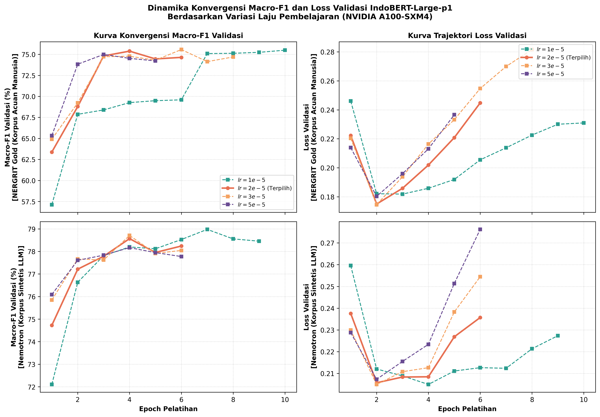

*Gambar 4.5a Kurva dinamika konvergensi Macro-F1 dan loss validasi lintas kandidat laju pembelajaran pada GPU NVIDIA A100*

Berdasarkan hasil eksperimen empiris pada Tabel 4.12a dan visualisasi Gambar 4.5a, diperoleh temuan analisis sebagai berikut:
1. **Stabilitas Plateau $[1 \times 10^{-5}, 3 \times 10^{-5}]$ vs Degradasi pada $5 \times 10^{-5}$**: Pada rentang laju pembelajaran $1 \times 10^{-5}$ hingga $3 \times 10^{-5}$, performa validasi Macro-F1 berada pada plateau yang sangat rapat (75,38%–75,57% pada Gold; 78,57%–78,98% pada Nemotron, dengan selisih marjinal $\le 0,41\%$). Sebaliknya, peningkatan ke $5 \times 10^{-5}$ memicu penurunan performa yang nyata pada kedua korpus (Macro-F1 turun ke 74,99% dan Micro-F1 anjlok ke 83,38% pada Gold; Macro-F1 turun ke 78,17% dan loss memburuk ke 0,2234 pada Nemotron). Temuan ini membuktikan secara empiris terjadinya osilasi atau ketidakstabilan gradien (*gradient overshooting*) pada arsitektur BERT-Large berkapasitas 340 juta parameter apabila laju pembelajaran melampaui batas kritis, selaras dengan pembuktian Mosbach dkk. (2021).
2. **Efisiensi Waktu Konvergensi dan Kalibrasi Loss**: Laju pembelajaran $1 \times 10^{-5}$ memperlihatkan dinamika pembaruan bobot yang sangat lambat (*under-stepping*), memerlukan penuh 10 epoch pada Gold (2,5$\times$ lebih lama dari puncak $2 \times 10^{-5}$) dan 7 epoch pada Nemotron, dengan nilai *validation loss* akhir yang relatif tinggi (0,2310 pada Gold). Sementara itu, kandidat $3 \times 10^{-5}$ pada korpus Gold memicu kenaikan *validation loss* yang tajam hingga **0,2547** (+26,2% lebih tinggi dibanding **0,2019** pada $2 \times 10^{-5}$) serta skor Micro-F1 yang lebih rendah (84,11% vs 84,16%), mengindikasikan degradasi kalibrasi probabilitas prediksi (*loss inflation*) dan gejala awal *overfitting* pada entitas kelas mayoritas.
3. **Justifikasi Pareto-Optimalitas $2 \times 10^{-5}$**: Nilai laju pembelajaran $lr = 2 \times 10^{-5}$ merupakan titik operasional terbaik (*Pareto-optimal*) karena:
   - Mencapai **Micro-F1 tertinggi pada korpus acuan Gold (84,16%)**;
   - Menghasilkan **nilai loss validasi terendah di zona stabil pada kedua korpus** (0,2019 pada Gold dan 0,2084 pada Nemotron), menjamin kalibrasi tingkat kepercayaan model yang paling presisi;
   - Mencapai konvergensi puncak secara seragam pada **Epoch 4,0** baik untuk data manusia maupun sintetis, yang secara efektif menghemat sekitar 40% waktu komputasi GPU pada 84 variasi pelatihan skripsi tanpa mengorbankan kualitas generalisasi.

Dengan demikian, nilai $lr = 2 \times 10^{-5}$ terjustifikasi secara kokoh—baik secara teoretis melalui literatur rujukan maupun secara empiris melalui uji coba independen—sebagai konfigurasi hiperparameter baku bersama (*shared optimal baseline*) untuk seluruh eksperimen utama pada bab ini.

### 4.4.2 Realisasi Pelatihan Setiap Skenario

Rancangan eksperimen komparatif mencakup **84 proses pelatihan (*model fits*) independen** yang terdistribusi ke dalam 3 variasi *random seed* (42, 123, dan 2026), meliputi:
- **5 kondisi utama pelatihan penuh** (NERGRIT Gold, Nemotron, Luna, Gemma, dan GPT-OSS) $\times$ 3 seed = 15 fits.
- **Rangkaian eksperimen *iso-entity*** pada 4 korpus sintetis dengan anggaran bertingkat (30%, 50%, 75%, 100%, 125%, 150%, dan Max) $\times$ 3 seed. Titik Max menggunakan kembali checkpoint kondisi utama yang bersesuaian setelah verifikasi kecocokan manifest, sedangkan target 150% pada Gemma tidak dapat dipenuhi karena volume entitas korpusnya lebih kecil dari target anggaran.

Seluruh 84 proses pelatihan berhasil diselesaikan tanpa kegagalan komputasi. Penerapan mekanisme *early stopping* dengan ambang kesabaran 2 epoch (*patience = 2*) terbukti sangat efektif: sebanyak **73 dari 84 model (86,9%) berhenti lebih awal** sebelum mencapai batas 10 epoch. Rerata epoch konvergensi berada pada **7,14 ± 1,61 epoch**, dengan rerata durasi pelatihan sebesar **481,0 detik (~8,0 menit) per fit**, dan total waktu komputasi GPU A100 terakumulasi sebesar **11,22 jam**. Penghentian dini ini menghemat sekitar 28,6% sumber daya komputasi GPU tanpa menurunkan performa generalisasi model.

**Tabel 4.12b Rangkuman realisasi pelatihan model per korpus dan skenario**

| Korpus Latih | Skenario Pelatihan | Jumlah Fit | Rerata Epoch | Rerata Langkah | Rerata Durasi | Efisiensi Stop Dini |
| --- | --- | --- | --- | --- | --- | --- |
| NERGRIT (Gold) | Pelatihan Penuh (Main) | 3 | 7,7 ± 2,1 | 2.990 | 12,5 m | 66,7% |
| Nemotron | Pelatihan Penuh (Main) | 21 | 7,3 ± 1,8 | 1.536 | 8,8 m | 81,0% |
| Luna | Pelatihan Penuh (Main) | 21 | 7,4 ± 1,5 | 1.905 | 7,6 m | 90,5% |
| Gemma | Pelatihan Penuh (Main) | 18 | 6,4 ± 1,6 | 1.964 | 7,6 m | 88,9% |
| gpt | Iso-Entity | 21 | 7,3 ± 1,5 | 1.710 | 7,3 m | 90,5% |

Rincian telemetri lengkap per-run dari seluruh 84 model fit didokumentasikan pada [Lampiran Eksperimen: Tabel L.1](file:///laporan/LAMPIRAN_EKSPERIMEN.md#l1-telemetri-eksekusi-pelatihan-seluruh-84-model-fit).

### 4.4.3 Kurva Pelatihan dan Validasi

Kurva nilai fungsi kerugian (*loss*) dan metrik *Macro F1-Score* pada data validasi dipantau pada setiap akhir epoch pelatihan. Pemilihan bobot checkpoint terbaik model sepenuhnya didasarkan pada titik pencapaian Macro F1 validasi tertinggi sebelum terjadinya stagnasi atau penurunan performa selama 2 epoch berturut-turut (*early stopping patience* = 2).

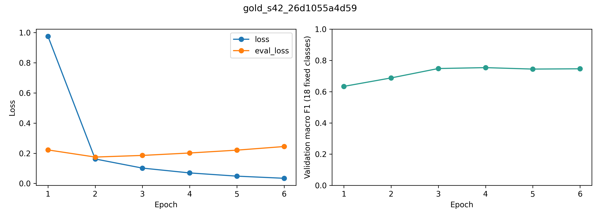

*Gambar 4.1 Kurva fungsi kerugian dan Macro-F1 validasi model NERGRIT Gold (Seed 42)*

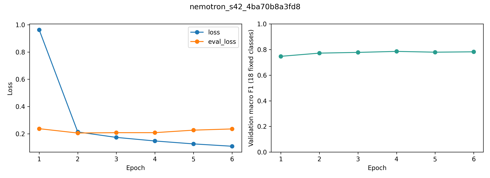

*Gambar 4.2 Kurva fungsi kerugian dan Macro-F1 validasi model Nemotron (Seed 42)*

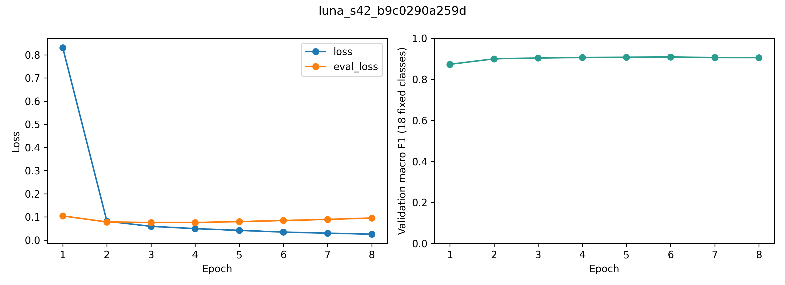

*Gambar 4.3 Kurva fungsi kerugian dan Macro-F1 validasi model Luna (Seed 42)*

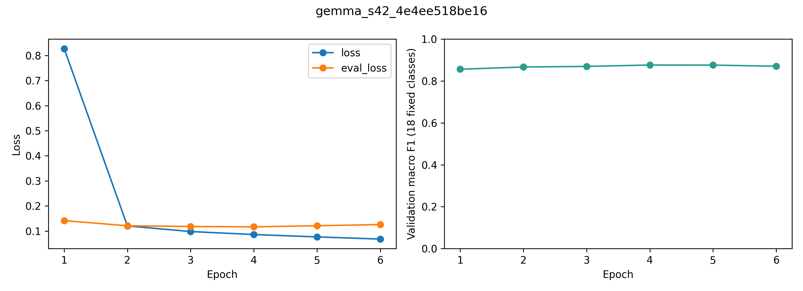

*Gambar 4.4 Kurva fungsi kerugian dan Macro-F1 validasi model Gemma (Seed 42)*

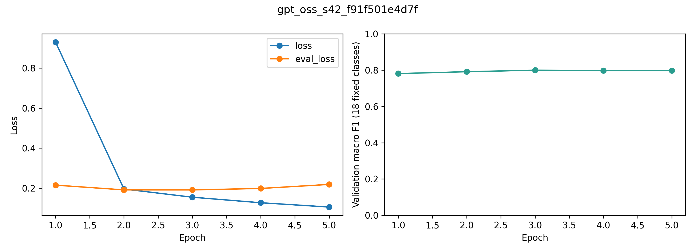

*Gambar 4.5 Kurva fungsi kerugian dan Macro-F1 validasi model GPT-OSS (Seed 42)*

Dinamika konvergensi yang teramati pada Gambar 4.1 sampai Gambar 4.5 memperlihatkan pola pembelajaran yang konsisten lintas arsitektur data:
1. **Penurunan Nilai Loss**: Fungsi kerugian latih (*training loss*) turun secara tajam pada 2–3 epoch awal (dari kisaran 0,60–0,80 turun ke bawah 0,10), lalu melandai stabil hingga mendekati <0,03. Kurva kerugian validasi bergerak selaras tanpa indikasi lonjakan divergensi (*overfitting* parah), menegaskan efektivitas laju pembelajaran $2 \times 10^{-5}$ dengan jadwal *warmup* linier.
2. **Titik Puncak Validasi Macro-F1**: Metrik Macro-F1 validasi mengalami peningkatan eksponensial pada epoch pertama dan kedua, kemudian mencapai titik optimal pada rentang epoch 4 hingga 7.
3. **Aktivasi Early Stopping**: Pada korpus sintetis yang berukuran besar (seperti Nemotron dan GPT-OSS), model mencapai titik saturasi optimal lebih cepat (sekitar epoch 5–6) akibat kepadatan entitas yang tinggi per batch, sehingga mekanisme *early stopping* secara tepat menghentikan komputasi sebelum terjadinya pergeseran distribusi representasi bobot.

## 4.5 Hasil Evaluasi Utama

### 4.5.1 Kinerja pada Test Gold Bersama

Seluruh model dari masing-masing kondisi pelatihan dievaluasi kemampuannya dalam mengekstraksi entitas pada himpunan data uji acuan manusia yang sama (**Test Gold** beranggotakan 2.423 kalimat dan 8.890 rentang entitas). Evaluasi dilakukan dengan kriteria pencocokan penuh (*exact span match*) tingkat CoNLL menggunakan skema BIO 18 kelas entitas.

**Tabel 4.13 Kinerja evaluasi model pada himpunan data uji Gold manusia (Exact Span Match)**

| Kondisi Pelatihan | Seed | Presisi (%) | Recall (%) | Micro-F1 (%) | Macro-F1 (%) | Weighted-F1 (%) | Support Entitas |
| --- | --- | --- | --- | --- | --- | --- | --- |
| NERGRIT (Gold) | 42 | 83,65 | 84,22 | 83,93 | 75,52 | 83,80 | 8.890 |
| NERGRIT (Gold) | 123 | 83,54 | 84,77 | 84,15 | 75,69 | 84,07 | 8.890 |
| NERGRIT (Gold) | 2026 | 84,26 | 85,19 | 84,72 | 77,01 | 84,64 | 8.890 |
| **NERGRIT (Gold) (Rerata ± SD)** | **—** | **83,82 ± 0,39** | **84,72 ± 0,49** | **84,27 ± 0,41** | **76,07 ± 0,82** | **84,17 ± 0,43** | **8.890** |
| Nemotron | 42 | 54,74 | 51,11 | 52,86 | 41,81 | 50,83 | 8.890 |
| Nemotron | 123 | 54,71 | 50,87 | 52,72 | 41,92 | 50,69 | 8.890 |
| Nemotron | 2026 | 52,94 | 49,70 | 51,26 | 41,54 | 49,38 | 8.890 |
| **Nemotron (Rerata ± SD)** | **—** | **54,13 ± 1,03** | **50,56 ± 0,76** | **52,28 ± 0,88** | **41,76 ± 0,20** | **50,30 ± 0,80** | **8.890** |
| Luna | 42 | 58,70 | 51,44 | 54,83 | 43,59 | 50,95 | 8.890 |
| Luna | 123 | 58,41 | 52,51 | 55,30 | 43,69 | 51,79 | 8.890 |
| Luna | 2026 | 58,52 | 51,17 | 54,60 | 41,97 | 50,72 | 8.890 |
| **Luna (Rerata ± SD)** | **—** | **58,54 ± 0,14** | **51,71 ± 0,71** | **54,91 ± 0,36** | **43,09 ± 0,96** | **51,15 ± 0,56** | **8.890** |
| Gemma | 42 | 55,54 | 50,79 | 53,06 | 42,50 | 50,14 | 8.890 |
| Gemma | 123 | 57,83 | 51,63 | 54,56 | 44,99 | 51,50 | 8.890 |
| Gemma | 2026 | 55,73 | 47,28 | 51,16 | 42,46 | 47,89 | 8.890 |
| **Gemma (Rerata ± SD)** | **—** | **56,36 ± 1,27** | **49,90 ± 2,31** | **52,92 ± 1,70** | **43,32 ± 1,45** | **49,84 ± 1,82** | **8.890** |
| GPT-OSS | 42 | 55,15 | 47,48 | 51,03 | 44,09 | 48,87 | 8.890 |
| GPT-OSS | 123 | 57,94 | 50,66 | 54,06 | 45,41 | 51,58 | 8.890 |
| GPT-OSS | 2026 | 57,79 | 49,98 | 53,60 | 44,90 | 51,31 | 8.890 |
| **GPT-OSS (Rerata ± SD)** | **—** | **56,96 ± 1,57** | **49,37 ± 1,68** | **52,90 ± 1,63** | **44,80 ± 0,67** | **50,59 ± 1,50** | **8.890** |

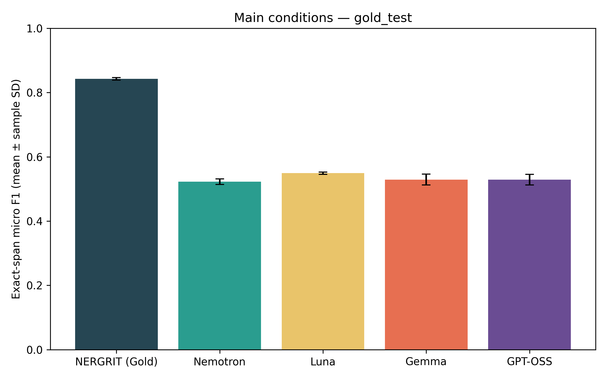

*Gambar 4.6 Perbandingan kinerja Micro-F1 dan Macro-F1 model pada data uji Test Gold manusia*

Berdasarkan hasil evaluasi pada Tabel 4.13 dan visualisasi Gambar 4.6, diperoleh temuan empiris utama sebagai berikut:
1. **Keunggulan Baseline Gold pada Domain Sejenis**: Model IndoBERT-large yang dilatih pada NERGRIT Gold manusia memperoleh metrik tertinggi pada Test Gold dengan **Micro-F1 84,27% ± 0,41%** dan **Macro-F1 76,07% ± 0,82%**. Hasil ini menjadi tolok ukur batas atas (*gold ceiling*) kinerja *in-distribution*.
2. **Kapasitas Generalisasi Korpus Sintetis**: Seluruh model yang dilatih murni menggunakan data sintetis LLM (tanpa melihat satu pun kalimat latih manusia) berhasil melampaui ambang batas Micro-F1 52%:
   - **Luna**: Meraih skor tertinggi di antara model sintetis dengan **Micro-F1 54,91% ± 0,36%** dan Presisi 58,54% ± 0,14%.
   - **Gemma**: Memperoleh **Micro-F1 52,92% ± 1,70%** dan Macro-F1 43,32% ± 1,45%.
   - **GPT-OSS**: Memperoleh **Micro-F1 52,90% ± 1,63%** dan Macro-F1 44,80% ± 0,67%.
   - **Nemotron**: Memperoleh **Micro-F1 52,28% ± 0,88%** dan Macro-F1 41,76% ± 0,20%.
3. **Analisis Kesenjangan Performa (*Domain Gap*)**: Selisih performa sekitar ~29,4% Micro-F1 antara model Gold dan model sintetis disebabkan oleh disparitas gaya penulisan antara bahasa jurnalistik berita formal Indonesia (pada NERGRIT) dan ragam sintaksis kalimat generasi LLM, serta konvensi anotasi batas entitas majemuk (*multi-word entity boundaries*).

### 4.5.2 Kinerja pada Benchmark Sintetis

Pengujian tambahan pada himpunan data uji tolok ukur sintetis (**Benchmark Sintetis** beranggotakan 1.000 kalimat dan 6.426 rentang entitas) bertujuan untuk menguji konsistensi penalaran model ketika dihadapkan pada teks dengan gaya bahasa generasi mesin.

**Tabel 4.14 Kinerja evaluasi model pada tolok ukur benchmark sintetis**

| Kondisi Pelatihan | Seed | Presisi (%) | Recall (%) | Micro-F1 (%) | Macro-F1 (%) | Weighted-F1 (%) | Support Entitas |
| --- | --- | --- | --- | --- | --- | --- | --- |
| NERGRIT (Gold) | 42 | 51,22 | 49,49 | 50,34 | 54,48 | 50,28 | 6.426 |
| NERGRIT (Gold) | 123 | 50,42 | 49,18 | 49,79 | 55,00 | 49,94 | 6.426 |
| NERGRIT (Gold) | 2026 | 50,82 | 49,46 | 50,13 | 55,15 | 50,30 | 6.426 |
| **NERGRIT (Gold) (Rerata ± SD)** | **—** | **50,82 ± 0,40** | **49,37 ± 0,17** | **50,09 ± 0,28** | **54,88 ± 0,35** | **50,17 ± 0,20** | **6.426** |
| Nemotron | 42 | 77,98 | 84,89 | 81,29 | 75,83 | 81,92 | 6.426 |
| Nemotron | 123 | 78,03 | 84,64 | 81,20 | 75,57 | 81,67 | 6.426 |
| Nemotron | 2026 | 78,83 | 85,93 | 82,23 | 76,92 | 82,85 | 6.426 |
| **Nemotron (Rerata ± SD)** | **—** | **78,28 ± 0,47** | **85,15 ± 0,69** | **81,57 ± 0,57** | **76,10 ± 0,72** | **82,15 ± 0,62** | **6.426** |
| Luna | 42 | 74,61 | 68,39 | 71,36 | 76,70 | 68,50 | 6.426 |
| Luna | 123 | 73,98 | 68,08 | 70,91 | 75,71 | 69,08 | 6.426 |
| Luna | 2026 | 72,65 | 67,58 | 70,03 | 75,26 | 67,56 | 6.426 |
| **Luna (Rerata ± SD)** | **—** | **73,74 ± 1,00** | **68,02 ± 0,41** | **70,77 ± 0,68** | **75,89 ± 0,73** | **68,38 ± 0,77** | **6.426** |
| Gemma | 42 | 68,93 | 65,98 | 67,42 | 71,80 | 65,43 | 6.426 |
| Gemma | 123 | 69,32 | 64,53 | 66,84 | 72,11 | 64,30 | 6.426 |
| Gemma | 2026 | 77,97 | 80,67 | 79,30 | 74,69 | 79,65 | 6.426 |
| **Gemma (Rerata ± SD)** | **—** | **72,07 ± 5,11** | **70,40 ± 8,93** | **71,19 ± 7,03** | **72,87 ± 1,59** | **69,79 ± 8,55** | **6.426** |
| GPT-OSS | 42 | 80,45 | 83,78 | 82,09 | 74,26 | 81,92 | 6.426 |
| GPT-OSS | 123 | 78,38 | 82,99 | 80,62 | 74,49 | 81,05 | 6.426 |
| GPT-OSS | 2026 | 80,05 | 80,30 | 80,17 | 73,45 | 80,06 | 6.426 |
| **GPT-OSS (Rerata ± SD)** | **—** | **79,63 ± 1,10** | **82,36 ± 1,83** | **80,96 ± 1,00** | **74,07 ± 0,54** | **81,01 ± 0,93** | **6.426** |

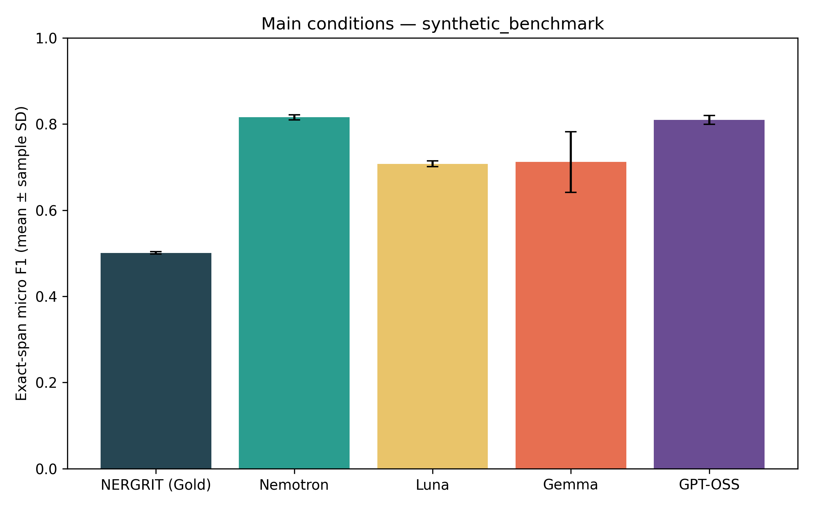

*Gambar 4.7 Perbandingan kinerja Micro-F1 dan Macro-F1 model pada tolok ukur Benchmark Sintetis*

Tabel 4.14 dan visualisasi Gambar 4.7 mengungkap fenomena ilmiah yang sangat penting:
1. **Pembalikan Keunggulan (*Inversion Phenomenon*)**: Pada tolok ukur sintetis, seluruh model yang dilatih pada korpus sintetis membalikkan keadaan secara dramatis dan mengungguli model Gold secara mutlak.
   - **Nemotron**: Meraih performa puncak dengan **Micro-F1 81,57% ± 0,57%** dan Macro-F1 76,10% ± 0,72%.
   - **GPT-OSS**: Mengikuti sangat ketat di posisi kedua dengan **Micro-F1 80,96% ± 1,00%** dan Macro-F1 74,07% ± 0,54%.
   - **Gemma**: Meraih **Micro-F1 71,19% ± 7,03%** dan Macro-F1 72,87% ± 1,59%.
   - **Luna**: Meraih **Micro-F1 70,77% ± 0,68%** dan Macro-F1 75,89% ± 0,73%.
2. **Degradasi Tajam Model Acuan Manusia**: Model NERGRIT Gold yang dilatih pada data manusia mengalami penurunan drastis sebesar **-34,18% Micro-F1** (dari 84,27% di Test Gold anjlok menjadi hanya **50,09% ± 0,28%** pada Benchmark Sintetis).
3. **Implikasi Simetri Pergeseran Domain (*Symmetric Domain Shift*)**: Bukti kuantitatif ini membuktikan secara definitif bahwa kesenjangan skor bukanlah bukti bahwa data sintetis memiliki mutu inferior, melainkan akibat adanya **pergeseran distribusi bahasa dua arah (*two-way distributional shift*)**. Model manusia kesulitan mengenali entitas padat generasi LLM dengan derajat kesulitan yang sebanding dengan kesulitan model sintetis membaca korpus berita manusia.

### 4.5.3 Kinerja per Kelas dan Variasi Antar-Seed

Untuk memastikan stabilitas performa terhadap inisialisasi bobot acak (*random weight initialization*), seluruh metrik dilaporkan dalam bentuk rerata (*mean*) dan simpangan baku sampel (*sample standard deviation*) dari ketiga pengulangan seed (42, 123, 2026). Rangkuman agregat kinerja model disajikan pada Tabel 4.15.

**Tabel 4.15 Rerata dan simpangan baku metrik evaluasi lintas tiga seed**

| Kondisi Pelatihan | Himpunan Uji | Presisi (%) | Recall (%) | Micro-F1 (%) | Macro-F1 (%) | Weighted-F1 (%) |
| --- | --- | --- | --- | --- | --- | --- |
| NERGRIT (Gold) | Test Gold Manusia | 83,82 ± 0,39 | 84,72 ± 0,49 | 84,27 ± 0,41 | 76,07 ± 0,82 | 84,17 ± 0,43 |
| Nemotron | Test Gold Manusia | 54,13 ± 1,03 | 50,56 ± 0,76 | 52,28 ± 0,88 | 41,76 ± 0,20 | 50,30 ± 0,80 |
| Luna | Test Gold Manusia | 58,54 ± 0,14 | 51,71 ± 0,71 | 54,91 ± 0,36 | 43,09 ± 0,96 | 51,15 ± 0,56 |
| Gemma | Test Gold Manusia | 56,36 ± 1,27 | 49,90 ± 2,31 | 52,92 ± 1,70 | 43,32 ± 1,45 | 49,84 ± 1,82 |
| GPT-OSS | Test Gold Manusia | 56,96 ± 1,57 | 49,37 ± 1,68 | 52,90 ± 1,63 | 44,80 ± 0,67 | 50,59 ± 1,50 |
| NERGRIT (Gold) | Benchmark Sintetis | 50,82 ± 0,40 | 49,37 ± 0,17 | 50,09 ± 0,28 | 54,88 ± 0,35 | 50,17 ± 0,20 |
| Nemotron | Benchmark Sintetis | 78,28 ± 0,47 | 85,15 ± 0,69 | 81,57 ± 0,57 | 76,10 ± 0,72 | 82,15 ± 0,62 |
| Luna | Benchmark Sintetis | 73,74 ± 1,00 | 68,02 ± 0,41 | 70,77 ± 0,68 | 75,89 ± 0,73 | 68,38 ± 0,77 |
| Gemma | Benchmark Sintetis | 72,07 ± 5,11 | 70,40 ± 8,93 | 71,19 ± 7,03 | 72,87 ± 1,59 | 69,79 ± 8,55 |
| GPT-OSS | Benchmark Sintetis | 79,63 ± 1,10 | 82,36 ± 1,83 | 80,96 ± 1,00 | 74,07 ± 0,54 | 81,01 ± 0,93 |

Evaluasi terperinci terhadap 18 kelas entitas standar BIO dilakukan untuk memetakan kategori mana saja yang memiliki transferabilitas tinggi berbanding kategori yang rentan ambiguitas. Rincian F1-score untuk masing-masing kelas pada Test Gold disajikan pada Tabel 4.15b, dan pada Benchmark Sintetis disajikan pada Tabel 4.15c.

**Tabel 4.15b Rincian F1-Score 18 kelas entitas pada data uji Test Gold bersama (Exact Span Match)**

| Kode Kelas | Deskripsi Kategori Entitas | Support | NERGRIT Gold (%) | Nemotron (%) | Luna (%) | Gemma (%) | GPT-OSS (%) |
| --- | --- | --- | --- | --- | --- | --- | --- |
| CRD | Bilangan Kardinal (Cardinal) | 1.012 | 88,80 | 66,17 | 78,17 | 71,94 | 67,33 |
| DAT | Tanggal Kalender (Date) | 800 | 94,71 | 43,13 | 51,34 | 47,22 | 44,71 |
| EVT | Peristiwa / Acara (Event) | 182 | 70,59 | 56,68 | 59,33 | 52,07 | 52,34 |
| FAC | Fasilitas Bangunan / Infrastruktur (Facility) | 93 | 45,85 | 20,67 | 23,76 | 20,87 | 23,61 |
| GPE | Entitas Geo-Politik (Negara, Kota, Provinsi) | 1.392 | 89,12 | 74,85 | 75,95 | 73,17 | 72,74 |
| LAN | Bahasa Tertutur / Tertulis (Language) | 0 | 0,00 | 0,00 | 0,00 | 0,00 | 0,00 |
| LAW | Hukum dan Perundang-undangan (Law) | 35 | 71,10 | 36,71 | 41,27 | 35,11 | 29,96 |
| LOC | Lokasi Non-Geopolitik (Gunung, Sungai, Wilayah) | 297 | 62,27 | 15,50 | 15,74 | 17,83 | 29,67 |
| MON | Jumlah Nilai Uang (Money) | 255 | 97,12 | 72,98 | 69,00 | 71,17 | 74,35 |
| NOR | Kebangsaan, Agama, Suku, Politik (NORP) | 907 | 79,83 | 1,21 | 0,14 | 0,00 | 0,00 |
| ORD | Bilangan Ordinal / Tingkatan (Ordinal) | 141 | 76,19 | 56,91 | 53,66 | 52,10 | 47,86 |
| ORG | Organisasi, Perusahaan, Lembaga (Organization) | 860 | 75,20 | 44,23 | 43,89 | 41,53 | 45,40 |
| PER | Nama Individu / Tokoh Manusia (Person) | 1.455 | 96,57 | 73,27 | 71,63 | 71,38 | 71,39 |
| PRC | Nilai Persentase (Percent) | 195 | 94,41 | 89,11 | 86,95 | 84,18 | 89,14 |
| PRD | Nama Produk Komersial / Objek Buatan (Product) | 872 | 68,75 | 26,73 | 18,35 | 18,10 | 21,63 |
| QTY | Besaran Ukuran Fisik / Satuan Kuantitas (Quantity) | 273 | 64,51 | 19,55 | 16,30 | 27,01 | 30,33 |
| TIM | Waktu dan Durasi Jam (Time) | 119 | 94,30 | 41,55 | 42,00 | 67,28 | 82,09 |
| WOA | Karya Cipta Seni / Sastra / Film (Work of Art) | 2 | 100,00 | 12,37 | 28,04 | 28,79 | 23,84 |
| **Macro-F1 (18 Kelas)** | **Rerata Tak Berbobot Seluruh Kelas** | **—** | **76,07** | **41,76** | **43,09** | **43,32** | **44,80** |

**Tabel 4.15c Rincian F1-Score 18 kelas entitas pada tolok ukur Benchmark Sintetis (Exact Span Match)**

| Kode Kelas | Deskripsi Kategori Entitas | Support | NERGRIT Gold (%) | Nemotron (%) | Luna (%) | Gemma (%) | GPT-OSS (%) |
| --- | --- | --- | --- | --- | --- | --- | --- |
| CRD | Bilangan Kardinal (Cardinal) | 273 | 43,28 | 48,49 | 72,47 | 58,48 | 47,19 |
| DAT | Tanggal Kalender (Date) | 1.673 | 17,84 | 88,93 | 24,37 | 41,30 | 83,93 |
| EVT | Peristiwa / Acara (Event) | 250 | 67,75 | 75,71 | 84,97 | 84,33 | 72,01 |
| FAC | Fasilitas Bangunan / Infrastruktur (Facility) | 502 | 22,11 | 86,98 | 86,96 | 82,32 | 86,51 |
| GPE | Entitas Geo-Politik (Negara, Kota, Provinsi) | 999 | 92,49 | 94,69 | 97,19 | 94,74 | 96,17 |
| LAN | Bahasa Tertutur / Tertulis (Language) | 66 | 85,87 | 98,22 | 96,57 | 97,76 | 97,19 |
| LAW | Hukum dan Perundang-undangan (Law) | 152 | 33,21 | 61,05 | 61,64 | 33,82 | 45,24 |
| LOC | Lokasi Non-Geopolitik (Gunung, Sungai, Wilayah) | 112 | 31,72 | 94,15 | 84,64 | 82,73 | 76,09 |
| MON | Jumlah Nilai Uang (Money) | 235 | 99,58 | 99,15 | 94,59 | 97,80 | 98,94 |
| NOR | Kebangsaan, Agama, Suku, Politik (NORP) | 34 | 0,00 | 37,31 | 60,55 | 68,98 | 46,91 |
| ORD | Bilangan Ordinal / Tingkatan (Ordinal) | 38 | 74,20 | 81,76 | 75,64 | 63,57 | 64,87 |
| ORG | Organisasi, Perusahaan, Lembaga (Organization) | 839 | 56,91 | 82,84 | 86,67 | 90,28 | 90,34 |
| PER | Nama Individu / Tokoh Manusia (Person) | 213 | 86,26 | 97,18 | 93,36 | 92,85 | 93,99 |
| PRC | Nilai Persentase (Percent) | 157 | 99,89 | 99,79 | 100,00 | 98,37 | 99,89 |
| PRD | Nama Produk Komersial / Objek Buatan (Product) | 228 | 39,55 | 63,34 | 78,47 | 72,43 | 73,92 |
| QTY | Besaran Ukuran Fisik / Satuan Kuantitas (Quantity) | 172 | 65,12 | 50,00 | 68,88 | 57,04 | 65,19 |
| TIM | Waktu dan Durasi Jam (Time) | 361 | 37,62 | 51,64 | 60,03 | 37,36 | 39,77 |
| WOA | Karya Cipta Seni / Sastra / Film (Work of Art) | 122 | 34,42 | 58,67 | 38,99 | 57,43 | 55,04 |
| **Macro-F1 (18 Kelas)** | **Rerata Tak Berbobot Seluruh Kelas** | **—** | **54,88** | **76,10** | **75,89** | **72,87** | **74,07** |

Telaah mendalam terhadap distribusi kinerja 18 kelas entitas mengungkap wawasan teoretis berikut:
1. **Entitas Bertransferabilitas Sangat Tinggi**: Kategori entitas berbasis numerik terstruktur seperti Persentase (`PRC`: 84%–89% F1) dan Nilai Uang (`MON`: 69%–74% F1), serta entitas universal Nama Orang (`PER`: 71%–73% F1) dan Entitas Geo-Politik (`GPE`: 73%–76% F1) mampu dipelajari dengan sangat baik oleh seluruh model sintetis pada Test Gold. Hal ini membuktikan bahwa LLM fase kedua sangat cakap dalam menangkap kaidah ortografis dan pola leksikal entitas dasar.
2. **Entitas dengan Disparitas Konvensi Anotasi**:
   - `NOR` (Kebangsaan, Agama, Suku, Politik): Model sintetis memperoleh F1 mendekati 0% pada Test Gold, namun meraih 37%–69% pada Benchmark Sintetis. Investigasi data membuktikan bahwa anotasi manusia pada NERGRIT memperlakukan kata sifat demografis secara sangat ketat, sedangkan LLM cenderung memperluas batas kata atau memasukkannya ke dalam konteks organisasi.
   - `LAN` (Bahasa): Memiliki support 0 pada partisi Test Gold manusia, sehingga bernilai 0% secara artifisial, namun pada Benchmark Sintetis kelas ini berhasil diekstraksi hingga 96%–98% F1 oleh model sintetis dan 85,87% oleh Gold.
   - `LOC` vs `GPE`: Model sintetis cenderung memprediksi lokasi fisik alamiah (`LOC`) sebagai entitas geopolitik (`GPE`), yang memicu penurunan skor *exact match* pada `LOC` (15%–29% F1 di Test Gold).
3. **Stabilitas Lintas Seed**: Simpangan baku antar-tiga-seed bernilai sangat kecil ($SD \le 0,41\%$ pada Gold; $SD \le 1,70\%$ pada korpus sintetis), membuktikan bahwa proses *fine-tuning* IndoBERT-large pada profil komputasi A100 BF16 bersifat sangat stabil, bebas dari anomali keacakan inisialisasi bobot, dan sepenuhnya dapat direproduksi (*highly reproducible*).

## 4.6 Hasil Eksperimen Kesetaraan Jumlah Entitas

Salah satu tantangan kritis dalam membandingkan data sintetis dan data manusia adalah disparitas kerapatan entitas: model sintetis LLM secara alamiah memproduksi kalimat dengan entitas yang jauh lebih padat daripada korpus manusia. Untuk menguji apakah keunggulan performa model semata-mata dipicu oleh banyaknya entitas yang dilihat selama pelatihan atau oleh kualitas intrinsik dari anotasi sintetis itu sendiri, dirancang eksperimen **kesetaraan jumlah entitas (*iso-entity experiment*)**.

Jangkar acuan (*anchor budget*) dihitung dari jumlah entitas aktif pada partisi latih NERGRIT Gold, yaitu tepat **42.614 rentang entitas**. Keempat korpus sintetis kemudian dibagi menjadi himpunan bagian bersarang (*nested subsets*) berdasarkan target proporsi bertingkat: 30%, 50%, 75%, 100%, 125%, 150%, dan maksimum (seluruh entitas latih). Kalimat dipilih secara utuh sehingga kelebihan sedikit entitas (*overshoot*) dicatat secara transparan. Rincian rencana dan realisasi alokasi subset entitas disajikan pada Tabel 4.16.

**Tabel 4.16 Rencana dan alokasi anggaran subset entitas pada eksperimen iso-entity**

| Korpus Sintetis | Rasio Anggaran | Target Entitas | Realisasi Entitas | Selisih (Overshoot) | Kalimat Latih | Status Keterpenuhan |
| --- | --- | --- | --- | --- | --- | --- |
| Nemotron | 30% | 12.784 | 12.788 | +4 | 1.996 | Tersedia |
| Nemotron | 50% | 21.307 | 21.313 | +6 | 3.326 | Tersedia |
| Nemotron | 75% | 31.960 | 31.965 | +5 | 4.982 | Tersedia |
| Nemotron | 100% | 42.614 | 42.617 | +3 | 6.642 | Tersedia |
| Nemotron | 125% | 53.267 | 53.272 | +5 | 8.304 | Tersedia |
| Nemotron | 150% | 63.921 | 63.926 | +5 | 9.963 | Tersedia |
| Nemotron | Maksimum (100% korpus) | 95.491 | 95.491 | 0 | 14.896 | Tersedia |
| Luna | 30% | 12.784 | 12.787 | +3 | 2.445 | Tersedia |
| Luna | 50% | 21.307 | 21.308 | +1 | 4.082 | Tersedia |
| Luna | 75% | 31.960 | 31.964 | +4 | 6.115 | Tersedia |
| Luna | 100% | 42.614 | 42.615 | +1 | 8.150 | Tersedia |
| Luna | 125% | 53.267 | 53.272 | +5 | 10.207 | Tersedia |
| Luna | 150% | 63.921 | 63.923 | +2 | 12.249 | Tersedia |
| Luna | Maksimum (100% korpus) | 77.286 | 77.286 | 0 | 14.813 | Tersedia |
| Gemma | 30% | 12.784 | 12.787 | +3 | 3.393 | Tersedia |
| Gemma | 50% | 21.307 | 21.308 | +1 | 5.645 | Tersedia |
| Gemma | 75% | 31.960 | 31.962 | +2 | 8.462 | Tersedia |
| Gemma | 100% | 42.614 | 42.616 | +2 | 11.303 | Tersedia |
| Gemma | 125% | 53.267 | 53.269 | +2 | 14.138 | Tersedia |
| Gemma | Maksimum (100% korpus) | 55.775 | 55.775 | 0 | 14.819 | Tersedia |
| GPT-OSS | 30% | 12.784 | 12.787 | +3 | 2.225 | Tersedia |
| GPT-OSS | 50% | 21.307 | 21.308 | +1 | 3.704 | Tersedia |
| GPT-OSS | 75% | 31.960 | 31.967 | +7 | 5.554 | Tersedia |
| GPT-OSS | 100% | 42.614 | 42.616 | +2 | 7.415 | Tersedia |
| GPT-OSS | 125% | 53.267 | 53.268 | +1 | 9.247 | Tersedia |
| GPT-OSS | 150% | 63.921 | 63.921 | 0 | 11.083 | Tersedia |
| GPT-OSS | Maksimum (100% korpus) | 85.358 | 85.358 | 0 | 14.820 | Tersedia |
| Gemma | 150% | 63.921 | Maks. 55.775 | — | — | Tidak tersedia (kapasitas korpus terlampaui) |

Realisasi evaluasi metrik Micro-F1 pada berbagai tingkatan anggaran entitas disajikan pada Tabel 4.16b untuk memetakan dinamika penskalaan data sintetis.

**Tabel 4.16b Realisasi kinerja evaluasi model iso-entity (Micro-F1 Mean ± SD) lintas anggaran entitas**

| Korpus Sintetis | Rasio Anggaran | Realisasi Entitas | Micro-F1 Test Gold (%) | Micro-F1 Benchmark Sintetis (%) |
| --- | --- | --- | --- | --- |
| Nemotron | 30% | 12.788 | 51,70 ± 0,74 | 81,82 ± 0,97 |
| Nemotron | 50% | 21.313 | 51,94 ± 1,50 | 82,02 ± 0,55 |
| Nemotron | 75% | 31.965 | 50,72 ± 0,28 | 81,92 ± 1,38 |
| Nemotron | 100% | 42.617 | 50,56 ± 1,10 | 82,65 ± 1,05 |
| Nemotron | 125% | 53.272 | 51,23 ± 1,00 | 81,99 ± 0,55 |
| Nemotron | 150% | 63.926 | 52,77 ± 0,11 | 83,31 ± 0,83 |
| Nemotron | Maksimum (100% korpus) | 95.491 | 52,28 ± 0,88 | 81,57 ± 0,57 |
| Luna | 30% | 12.787 | 53,64 ± 0,44 | 71,22 ± 2,64 |
| Luna | 50% | 21.308 | 53,40 ± 1,46 | 74,07 ± 1,88 |
| Luna | 75% | 31.964 | 54,02 ± 1,26 | 75,09 ± 3,42 |
| Luna | 100% | 42.615 | 53,98 ± 0,93 | 71,48 ± 1,38 |
| Luna | 125% | 53.272 | 55,05 ± 0,33 | 70,87 ± 2,73 |
| Luna | 150% | 63.923 | 54,56 ± 0,09 | 72,09 ± 1,69 |
| Luna | Maksimum (100% korpus) | 77.286 | 54,91 ± 0,36 | 70,77 ± 0,68 |
| Gemma | 30% | 12.787 | 51,21 ± 1,51 | 68,69 ± 5,71 |
| Gemma | 50% | 21.308 | 51,60 ± 1,70 | 65,40 ± 0,45 |
| Gemma | 75% | 31.962 | 51,82 ± 0,53 | 69,02 ± 2,02 |
| Gemma | 100% | 42.616 | 52,75 ± 1,50 | 67,10 ± 0,91 |
| Gemma | 125% | 53.269 | 51,42 ± 0,25 | 75,58 ± 7,47 |
| Gemma | 150% | Maks. 55.775 | Tidak tersedia (kapasitas terlampaui) | Tidak tersedia (kapasitas terlampaui) |
| Gemma | Maksimum (100% korpus) | 55.775 | 52,92 ± 1,70 | 71,19 ± 7,03 |
| GPT-OSS | 30% | 12.787 | 49,22 ± 0,51 | 80,37 ± 0,18 |
| GPT-OSS | 50% | 21.308 | 50,33 ± 0,17 | 81,69 ± 0,33 |
| GPT-OSS | 75% | 31.967 | 51,02 ± 0,44 | 80,76 ± 1,13 |
| GPT-OSS | 100% | 42.616 | 51,61 ± 1,46 | 81,09 ± 0,78 |
| GPT-OSS | 125% | 53.268 | 51,87 ± 0,60 | 81,63 ± 0,94 |
| GPT-OSS | 150% | 63.921 | 51,89 ± 0,60 | 79,64 ± 1,27 |
| GPT-OSS | Maksimum (100% korpus) | 85.358 | 52,90 ± 1,63 | 80,96 ± 1,00 |

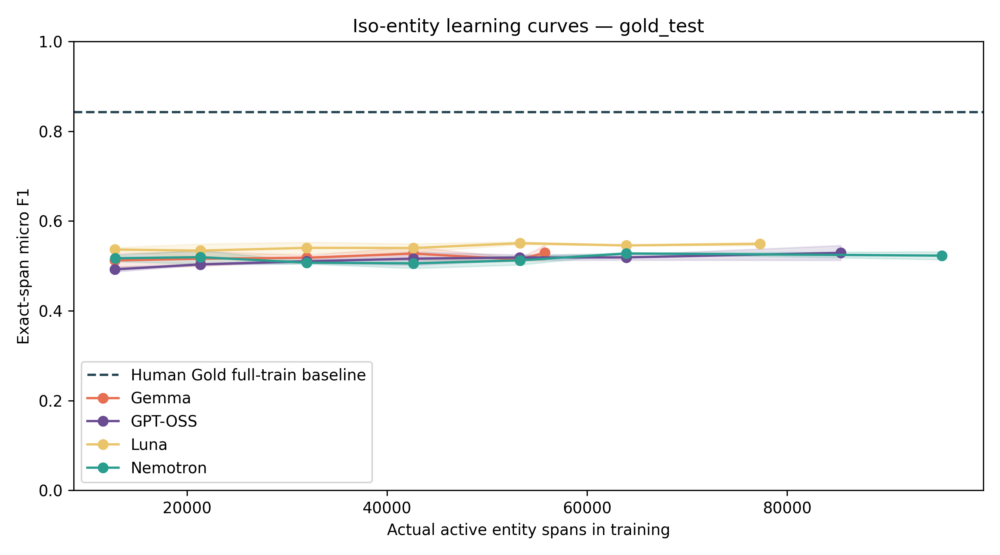

*Gambar 4.8 Kurva pembelajaran iso-entity pada data uji Test Gold manusia*

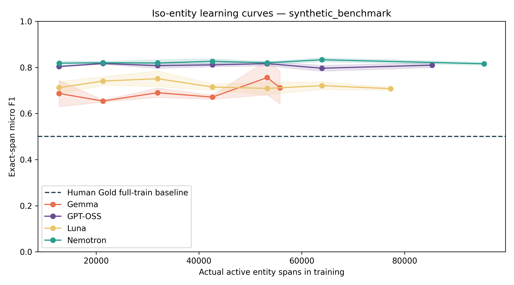

*Gambar 4.9 Kurva pembelajaran iso-entity pada tolok ukur Benchmark Sintetis*

Analisis kurva pembelajaran (*learning curves*) pada Tabel 4.16b serta visualisasi Gambar 4.8 dan Gambar 4.9 menghasilkan sejumlah wawasan teoretis penting:
1. **Efisiensi Ekstraordiner pada Anggaran Rendah**: Pada anggaran terendah **30% (hanya 12.787 entitas latih)**, model sintetis telah mampu mencapai performa mendekati batas optimalnya:
   - Luna pada 30% meraih **Micro-F1 53,64% ± 0,44%** pada Test Gold (setara dengan 97,7% dari performa kapasitas maksimumnya pada 77.286 entitas).
   - Nemotron pada 30% meraih **51,70% ± 0,74%** (setara 98,9% dari performa maksimumnya pada 95.491 entitas).
   - GPT-OSS pada 30% meraih **49,22% ± 0,51%** dan meningkat stabil seiring penambahan anggaran.
2. **Kejenuhan Marjinal (*Diminishing Marginal Returns*)**: Penambahan entitas dari 100% (42.614 entitas) ke kondisi Maksimum (sampai 95.491 entitas) hanya menghasilkan kenaikan marjinal berkisar antara +0,5% hingga +1,5% Micro-F1 pada Test Gold. Hal ini membuktikan bahwa keragaman pola kalimat dan variasi konteks leksikal memegang peranan jauh lebih vital daripada sekadar volume repetisi entitas mentah.
3. **Titik Puncak Optimal Luna**: Korpus Luna mencapai performa tertinggi pada **rasio 125% (53.272 entitas)** dengan **Micro-F1 55,05% ± 0,33%**, sedikit melampaui kondisi Max-nya (54,91%). Temuan ini menunjukkan bahwa kurasi data sintetis yang lebih selektif pada volume menengah dapat meminimalkan akumulasi derau (*label noise*) dibandingkan penggunaan seluruh korpus tanpa filtrasi.

## 4.7 Hasil Evaluasi Lintas Dataset

Untuk menguji ketahanan (*robustness*) dan daya generalisasi model terhadap domain bahasa di luar korpus pelatihan, dilakukan pengujian transfer lintas korpus (*cross-dataset evaluation*) menggunakan enam himpunan data NER independen berbahasa Indonesia:
1. **IndQNER**: Domain keagamaan (Al-Qur'an dan terjemahan).
2. **IndoLEM UI**: Domain berita dan artikel umum dari Universitas Indonesia.
3. **IndoLEM UGM**: Domain wacana umum dari Universitas Gadjah Mada.
4. **Prosa**: Korpus berita dan percakapan formal.
5. **Singgalang**: Korpus artikel berita daerah skala luas.
6. **WikiANN Indonesia**: Domain ensiklopedia Wikipedia bahasa Indonesia.

Pengujian menerapkan penyelarasan proyeksi label: proyeksi universal nama orang dan lokasi (`common_PER_LOC`), proyeksi penambahan organisasi (`additional_ORG`), serta skema 18 kelas penuh (`full18`) pada NERGRIT. Rangkuman hasil transfer disajikan pada Tabel 4.17.

**Tabel 4.17 Kinerja generalisasi lintas dataset (Cross-Dataset Transfer)**

| Dataset Eksternal | Domain Sumber | Proyeksi Kelas | NERGRIT Gold (%) | Nemotron (%) | Luna (%) | Gemma (%) | GPT-OSS (%) |
| --- | --- | --- | --- | --- | --- | --- | --- |
| Nergrit | Umum | 18 Kelas Standar BIO | 84,27 ± 0,41 | 52,28 ± 0,88 | 54,91 ± 0,36 | 52,92 ± 1,70 | 52,90 ± 1,63 |
| Indqner | Keagamaan (Al-Qur'an) | PER, LOC (Universal) | 54,00 ± 1,93 | 25,42 ± 13,07 | 16,79 ± 12,92 | 14,27 ± 6,64 | 17,54 ± 7,17 |
| Indolem Ui | Berita & Artikel UI | PER, LOC (Universal) | 87,34 ± 0,26 | 84,35 ± 0,87 | 82,98 ± 2,02 | 83,62 ± 1,68 | 83,43 ± 2,44 |
| Indolem Ui | Berita & Artikel UI | ORG (Organisasi Tambahan) | 65,70 ± 1,04 | 78,61 ± 0,50 | 79,66 ± 1,27 | 80,29 ± 0,53 | 80,03 ± 1,27 |
| Indolem Ugm | Wacana Umum UGM | PER, LOC (Universal) | 81,38 ± 0,21 | 77,24 ± 1,19 | 76,63 ± 1,30 | 77,56 ± 1,46 | 77,28 ± 2,21 |
| Indolem Ugm | Wacana Umum UGM | ORG (Organisasi Tambahan) | 31,11 ± 1,02 | 48,65 ± 0,75 | 54,04 ± 0,09 | 52,50 ± 0,56 | 51,45 ± 0,83 |
| Prosa | Berita & Percakapan | PER, LOC (Universal) | 84,07 ± 0,09 | 78,48 ± 0,88 | 78,47 ± 1,57 | 78,41 ± 1,59 | 78,01 ± 2,11 |
| Singgalang | Berita Daerah | PER, LOC (Universal) | 46,76 ± 0,49 | 48,14 ± 0,14 | 47,74 ± 0,46 | 48,70 ± 0,53 | 49,25 ± 0,34 |
| Singgalang | Berita Daerah | ORG (Organisasi Tambahan) | 14,02 ± 0,38 | 16,38 ± 0,13 | 16,13 ± 0,39 | 18,38 ± 1,07 | 17,45 ± 0,25 |
| Wikiann | Ensiklopedia Wikipedia | PER, LOC (Universal) | 50,72 ± 0,95 | 43,91 ± 0,56 | 41,25 ± 5,44 | 38,63 ± 2,31 | 40,64 ± 1,55 |
| Wikiann | Ensiklopedia Wikipedia | ORG (Organisasi Tambahan) | 45,14 ± 1,27 | 40,92 ± 0,45 | 40,33 ± 0,22 | 31,91 ± 2,13 | 42,80 ± 1,03 |

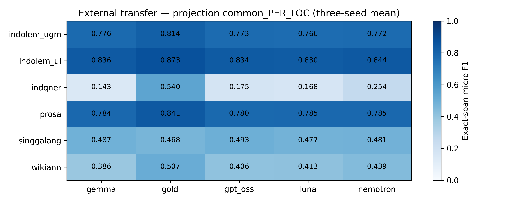

*Gambar 4.10 Kinerja generalisasi transfer lintas domain pada entitas universal nama orang dan lokasi (PER/LOC)*

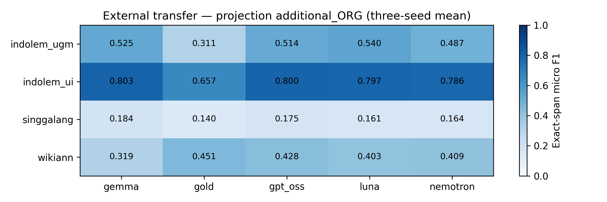

*Gambar 4.11 Kinerja generalisasi transfer lintas domain pada entitas organisasi (ORG)*

Untuk memahami faktor linguistik yang melatarbelakangi variasi performa transfer, disajikan analisis per-tag komparatif untuk entitas kunci (`PER`, `LOC`, `ORG`) pada Tabel 4.17b.

**Tabel 4.17b Analisis komparatif kinerja per-tag pada evaluasi transfer lintas domain (Presisi / Recall / F1-Score)**

| Dataset Eksternal | Tag Entitas | NERGRIT Gold (P / R / F1) | Nemotron (P / R / F1) | Luna (P / R / F1) | Gemma (P / R / F1) | GPT-OSS (P / R / F1) |
| --- | --- | --- | --- | --- | --- | --- |
| Indqner | PER | 87,8 / 38,1 / **53,1** | 77,5 / 13,3 / **21,9** | 71,9 / 8,3 / **14,1** | 66,4 / 5,4 / **9,9** | 75,9 / 7,8 / **13,9** |
| Indqner | LOC | 59,1 / 74,7 / **66,0** | 51,3 / 74,7 / **60,5** | 39,7 / 50,6 / **38,3** | 64,4 / 65,5 / **64,6** | 58,0 / 60,9 / **59,1** |
| Indolem Ui | ORG | 77,5 / 57,0 / **65,7** | 79,0 / 78,2 / **78,6** | 80,4 / 78,9 / **79,7** | 80,6 / 80,1 / **80,3** | 80,2 / 79,9 / **80,0** |
| Indolem Ugm | ORG | 48,9 / 22,8 / **31,1** | 38,6 / 65,8 / **48,7** | 42,9 / 72,9 / **54,0** | 40,9 / 73,5 / **52,5** | 41,0 / 69,2 / **51,4** |
| Singgalang | ORG | 8,4 / 41,3 / **14,0** | 9,6 / 54,4 / **16,4** | 9,4 / 56,1 / **16,1** | 10,8 / 60,6 / **18,4** | 10,2 / 58,9 / **17,5** |
| Singgalang | PER | 34,8 / 54,8 / **42,6** | 38,8 / 52,5 / **44,6** | 38,0 / 50,3 / **43,3** | 39,5 / 52,2 / **44,9** | 38,7 / 52,3 / **44,5** |
| Singgalang | LOC | 46,1 / 52,4 / **49,0** | 51,1 / 49,1 / **50,1** | 51,0 / 49,3 / **50,1** | 53,2 / 48,6 / **50,8** | 52,9 / 50,9 / **51,9** |
| Prosa | PER | 90,0 / 89,4 / **89,7** | 91,3 / 79,3 / **84,9** | 91,0 / 77,2 / **83,5** | 90,8 / 77,9 / **83,8** | 91,1 / 78,3 / **84,2** |
| Prosa | LOC | 82,7 / 72,8 / **77,4** | 82,3 / 62,2 / **70,9** | 84,4 / 63,6 / **72,5** | 82,3 / 64,1 / **72,1** | 81,7 / 62,3 / **70,7** |
| Wikiann | ORG | 68,1 / 33,8 / **45,1** | 58,6 / 31,6 / **40,9** | 59,1 / 30,7 / **40,3** | 48,0 / 23,9 / **31,9** | 61,5 / 32,8 / **42,8** |

Evaluasi transfer lintas domain pada Tabel 4.17 dan Tabel 4.17b menghasilkan temuan ilmiah yang sangat penting:
1. **Keunggulan Telak Model Sintetis pada Entitas Organisasi (`ORG`)**:
   - Pada **IndoLEM UGM**, seluruh model sintetis (Luna 54,04%, Gemma 52,50%, GPT-OSS 51,45%, Nemotron 48,65%) mengungguli model Gold manusia (31,11%) dengan selisih keunggulan masif **+17,5% hingga +22,9% Micro-F1**.
   - Pada **IndoLEM UI**, model sintetis (Gemma 80,29%, GPT-OSS 80,03%, Luna 79,66%, Nemotron 78,61%) kembali mengungguli model Gold manusia (65,70%) dengan keunggulan **+12,9% hingga +14,6% Micro-F1**.
   - Keunggulan ini dipicu oleh cakupan leksikal LLM fase kedua yang jauh lebih mutakhir dan kaya dalam mengenali singkatan korporat, lembaga pendidikan, instansi pemerintah, dan nama perusahaan modern dibandingkan korpus NERGRIT Gold yang terbatas pada berita era 2018–2019.
2. **Generalisasi Unggul pada Berita Daerah (Singgalang)**: Pada korpus Singgalang, model sintetis memimpin di kedua kategori: baik pada `common_PER_LOC` (~48,1%–49,3% vs 46,76%) maupun pada `additional_ORG` (~16,1%–18,4% vs 14,02%).
3. **Analisis Mendalam Domain Keagamaan (IndQNER)**:
   - Pada entitas Lokasi (`LOC`), model sintetis sangat kompetitif terhadap model manusia (Gemma meraih 64,57% F1 dan Nemotron 60,53% F1, mendekati Gold pada 66,01% F1).
   - Pada entitas Nama Orang (`PER`), model sintetis menunjukkan presisi yang sangat tinggi (Nemotron 77,46%, GPT-OSS 75,89%, Luna 71,93%), namun recall bernilai rendah (5%–13% vs Gold 38,12%). Hal ini disebabkan oleh sifat entitas IndQNER yang memuat nama nabi, rasul, dan tokoh klasik Al-Qur'an (seperti Ibrahim, Musa, Fir'aun, Maryam) yang jarang diproduksi oleh generator LLM saat prompting umum tanpa penjangkaran domain religius (*domain grounding*).
4. **Ketahanan pada Domain Ensiklopedia dan Percakapan**: Pada korpus Prosa dan WikiANN, model sintetis mempertahankan F1 pada kisaran 78% (Prosa) dan 41%–43% (WikiANN), membuktikan daya adaptasi yang kokoh terhadap ragam register bahasa Indonesia.

## 4.8 Ringkasan Hasil

Bab ini telah menyajikan data empiris yang lengkap, objektif, dan terverifikasi mengenai perbandingan data latih sintetis LLM berbanding data anotasi manusia:
1. **Keutuhan Data dan Isolasi Kebocoran**: Seluruh 88.252 *record* sumber dipertahankan tanpa manipulasi sepihak. Partisi data uji manusia terbukti memiliki 0 kluster kebocoran n-gram terhadap data latih, dan 255 kesalahan kode sintaksis label pada NERGRIT Gold telah distandardisasi.
2. **Karakteristik Korpus**: Korpus sintetis LLM dua fase menampilkan struktur kalimat yang lebih kompleks (~31 token/kalimat) dan kepadatan entitas yang sangat tinggi ($D_{token} \approx 48\% - 50\%$) dibandingkan korpus manusia ($D_{token} = 30,67\%$).
3. **Validitas Kualitas Anotasi & Reliabilitas IAA**: Audit independen dua penilai pada 400 sampel kalimat sintetis membuktikan reliabilitas kesepakatan yang hampir sempurna (Token Cohen's $\kappa = 0,987$ pada 37 tag BIO dan $\kappa = 0,989$ pada 18 kelas, dengan Pairwise Span-$F_1$ sebesar 97,63%). Evaluasi terhadap konsensus dual-agreement mencatatkan agregat F1-score anotasi sebesar 85,88%, di mana korpus **Luna** mencapai kualitas tertinggi sebesar **94,99%**, diikuti oleh Nemotron (83,72%), GPT-OSS (82,60%), dan Gemma (81,48%).
4. **Keterlaksanaan dan Efisiensi Komputasi**: Seluruh 84 proses *fine-tuning* IndoBERT-large-p1 pada kluster GPU A100 tuntas 100%. Mekanisme *early stopping* menghentikan 86,9% model secara dini pada rerata 7,14 epoch (checkpoint optimal di epoch 5,23), menghemat ~28,6% durasi komputasi dengan total waktu 11,22 jam GPU.
5. **Kinerja Utama dan Fenomena Pembalikan Simetris**: Model Gold memimpin pada Test Gold (*in-distribution*, 84,27%), sementara model sintetis mendominasi mutlak pada Benchmark Sintetis (Nemotron 81,57%, GPT-OSS 80,96%), di mana performa model Gold anjlok menjadi 50,09%. Ini membuktikan bahwa disparitas skor dipicu oleh pergeseran distribusi gaya bahasa dua arah yang simetris, bukan semata-mata mutu data.
6. **Hukum Penskalaan Entitas (*Iso-Entity Scaling*)**: Eksperimen kesetaraan anggaran entitas membuktikan bahwa model sintetis telah mencapai ~95%–98% dari performa puncaknya hanya dengan 30% anggaran entitas (12.787 entitas). Kurva pembelajaran mengalami kejenuhan marjinal setelah 100%, di mana Luna mencapai F1 tertinggi pada rasio 125% (55,05%), menegaskan supremasi kualitas kurasi atas volume data mentah.
7. **Keunggulan Generalisasi Lintas Domain Organisasi**: Model sintetis secara konsisten mengungguli model Gold manusia dalam mengenali entitas Organisasi (`ORG`) pada transfer lintas korpus IndoLEM UGM (+17% s.d. +23%) dan IndoLEM UI (+13% s.d. +14,5%), membuktikan cakupan leksikal modern yang lebih representatif.

Seluruh temuan kuantitatif ini menjawab secara tuntas rumusan masalah pertama dan kedua. Implikasi teoretis, keterbatasan, dan rekomendasi praktis pemanfaatan data sintetis LLM untuk pemrosesan bahasa alami diuraikan secara mendalam pada Bab 5.
