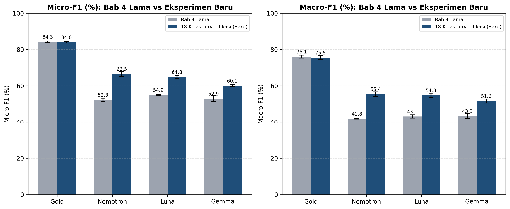
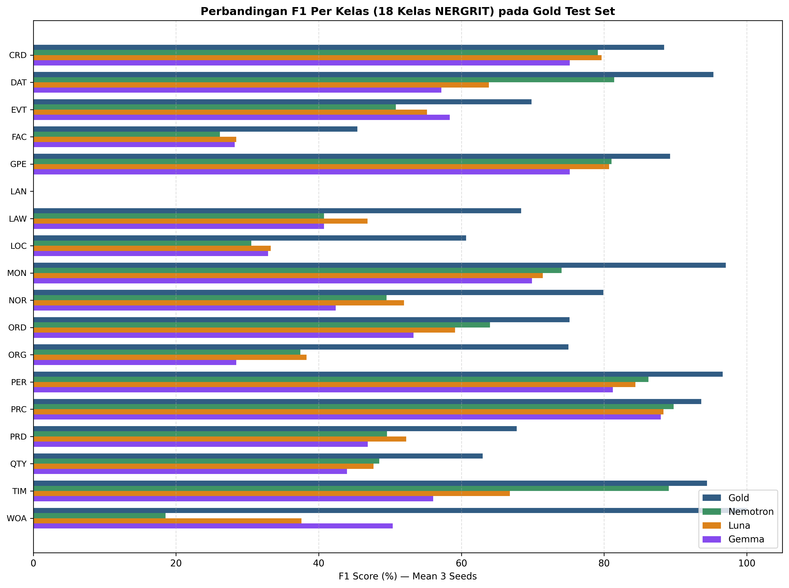
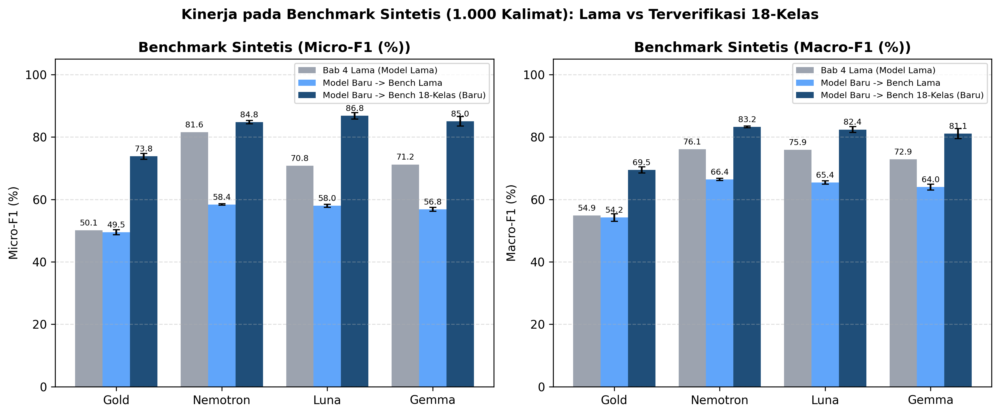
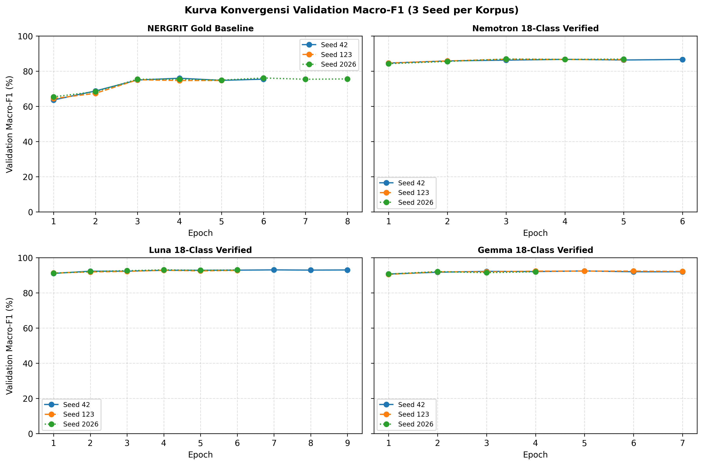
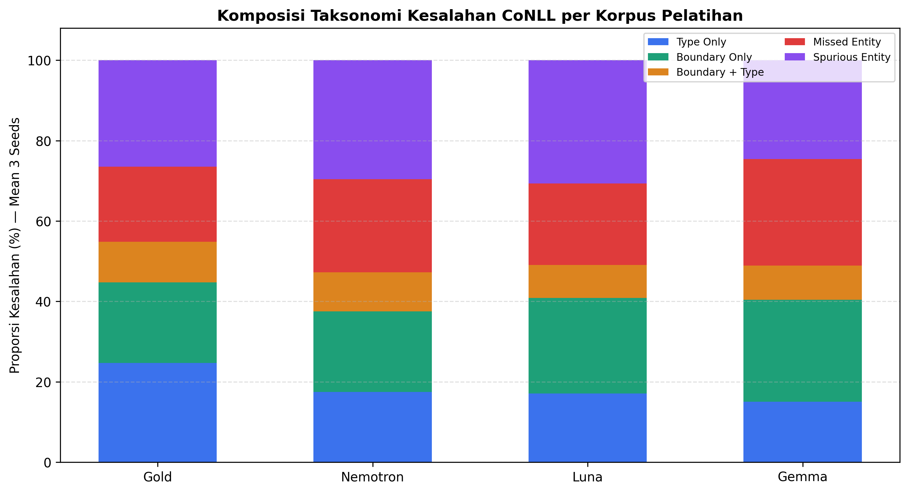
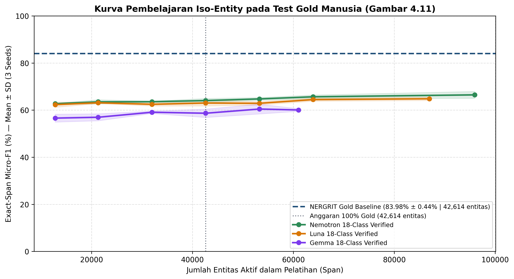
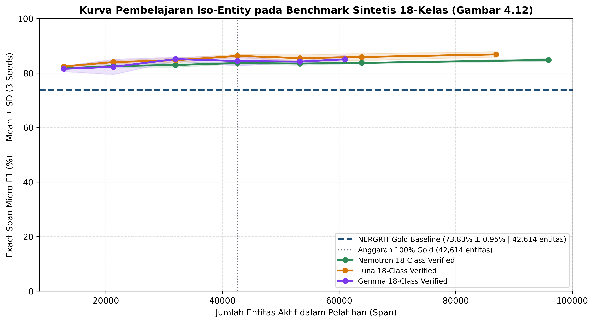
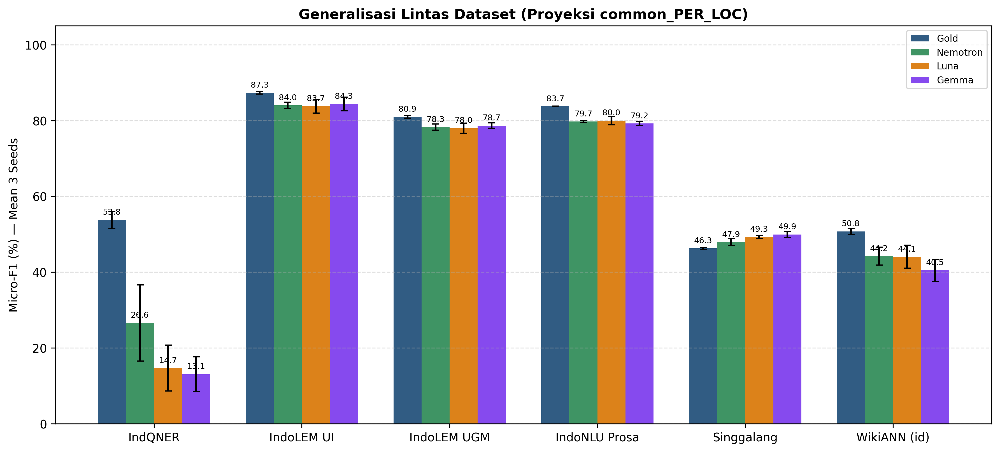
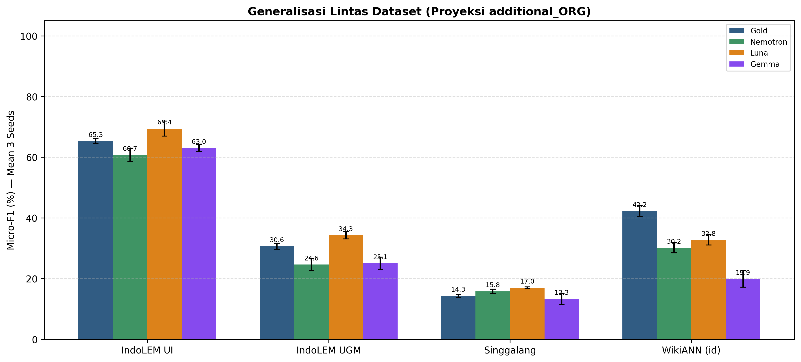

# Laporan Progres Bimbingan Skripsi — Re-Verifikasi Data 18-Kelas, Audit IAA, & Eksperimen Penuh (3 Seeds)

> **Konteks:** Ringkasan pembaruan riset sejak bimbingan terakhir hingga selesainya seluruh eksperimen **18-Kelas (`0 REG`, `0 TTL`)** pada `indobenchmark/indobert-large-p1` (`3` random seeds: `[42, 123, 2026]`, presisi `bf16`).

---

## Ringkasan Pencapaian Utama (*Before vs. After*)

| Aspek Penelitian | Kondisi Bimbingan Sebelumnya | Status Terkini (Final 18-Kelas) | Dampak / Kenaikan |
| :--- | :--- | :--- | :--- |
| **Taksonomi & Data Latih** | `20` kelas (campuran `TTL`/`REG` & batas `PER`/`NOR`/`DAT` belum konsisten) | **Re-verifikasi Stage-2 penuh ke `18` kelas NERGRIT (`0 REG`, `0 TTL`)** + aturan *post-processing* terpadu | Anomali nol pada `NOR` & fragmentasi `DAT` teratasi |
| **Audit Kualitas Data (IAA)** | `400` sampel pra-perbaikan (`85,88%` F1 konsensus) | **`300` sampel terstratifikasi post-fix** (`cx/gpt-6-luna` vs `ag/gemini-3.8-flash-high`) | Kualitas konsensus naik ke **`96,36%`** ($\kappa_{\text{BIO}} = 0,959$) |
| **Test Gold Manusia (`2.423` kalimat)** | Nemotron `52,28%`, Luna `54,91%`, Gemma `52,92%` | **Nemotron `66,47%`**, **Luna `64,80%`**, **Gemma `60,05%`** | Lonjakan masif **`+7,13%` s.d. `+14,19%`** Micro-F1 |
| **Benchmark Sintetis (`1.000` kalimat)** | Benchmark versi lama (belum terverifikasi 18-kelas) | **Benchmark Sintetis 18-Kelas Terverifikasi (`cx/gpt-6-luna`)**: Luna **`86,80%`**, Gemma **`85,01%`**, Nemotron **`84,76%`**, Gold **`73,83%`** | Bukti *Symmetric Domain Shift* makin kokoh (`+11%`–`+13%` atas Gold) |
| **Eksperimen Iso-Entity Scaling** | Data lama pra-perbaikan (`20` kelas) | **`63` evaluasi selesai penuh (`30%`–`150%` + `Max` $\times$ `3` seed)** | Sejak anggaran `30%` sudah mencapai **`62,3%–62,7%`** F1 |
| **Transfer Lintas Dataset (`6` Korpus)** | Proyeksi lama `PER/LOC` & `ORG` | **Re-evaluasi `12` model baru + proyeksi `additional_ORG_plus_NOR`** | Menjelaskan beda konvensi `ORG` vs `NOR` secara kuantitatif |

---

## 1. Akar Masalah Data Lama & Perbaikan Pipeline Stage-2 (`18` Kelas Resmi)

Pada hasil Bab 4 sebelumnya, model sintetis hanya mencapai `~52%–55%` Micro-F1 di Test Gold karena tiga masalah konvensi anotasi:
1. **Pergeseran label gelar & politik:** Jabatan/gelar (`TTL`) dan kebangsaan/afiliasi kenegaraan (`NOR`, `REG`) belum selaras dengan aturan baku NERGRIT (`18` kelas aktif: `CRD, DAT, EVT, FAC, GPE, LAN, LAW, LOC, MON, NOR, ORD, ORG, PER, PRC, PRD, QTY, TIM, WOA`).
2. **Inkonsistensi batas majemuk `DAT` & `PER`:** Tanggal majemuk (*hari, tanggal bulan tahun*) pada korpus Nemotron sempat terpecah menjadi fragmen-fragmen kecil (`21.865` entitas `DAT` terpecah $\rightarrow$ dirapikan menjadi **`16.219`** rentang utuh); gelar profesi/militer di depan nama orang diselaraskan melalui modul seragam `scripts/nergrit_postprocess.py`.
3. **Standarisasi Benchmark Sintetis Uji:** `1.000` kalimat *Synthetic Benchmark* juga diverifikasi ulang ke skema 18-kelas agar pengujian domain sintetis adil dan bebas kontaminasi `REG`/`TTL`.

### Statistik Korpus Final (`18` Kelas, Partisi *Zero-Leakage Group Split*)

| Korpus Pelatihan | Train (Kalimat) | Validation (Kalimat) | Test (Kalimat) | Total Kalimat | Total Entitas Aktif | Densitas Token Entitas (`%`) |
| :--- | :---: | :---: | :---: | :---: | :---: | :---: |
| **NERGRIT Gold Baseline** | `12.465` | `2.543` | `2.423` | **`17.431`** | `59.994` (`8.890` di Test) | `30,12%` |
| **Nemotron 18-Class Verified** | `14.896` | `2.629` | *(uji ke Gold & Bench)* | **`17.525`** | `112.945` | `54,82%` |
| **Luna 18-Class Verified** | `14.813` | `2.614` | *(uji ke Gold & Bench)* | **`17.427`** | `102.272` | `51,68%` |
| **Gemma 18-Class Verified** | `14.819` | `2.615` | *(uji ke Gold & Bench)* | **`17.434`** | `71.801` | `42,06%` |

---

## 2. Validasi Kualitas Anotasi: Audit IAA Independen (`300` Sampel Post-Fix)

Untuk membuktikan reliabilitas anotasi 18-kelas sebelum melatih model, dilakukan audit dua penilai independen (**Annotator A1:** `cx/gpt-6-luna`, **Annotator A2:** `ag/gemini-3.8-flash-high`) pada **`300` sampel terstratifikasi** (`100` kalimat per korpus, total **`7.668` token**):

| Korpus | Cohen's $\kappa$ (37 Tag BIO) | Cohen's $\kappa$ (18 Kelas) | Pairwise Span-F1 | Presisi Konsensus | Recall Konsensus | **F1 Kualitas Konsensus** |
| :--- | :---: | :---: | :---: | :---: | :---: | :---: |
| **Nemotron 18-Class (Post-DAT Fix)** | `0,943` | `0,955` | `90,21%` | `94,12%` | `95,30%` | **`94,70%`** *(naik dari `91,82%` pra-fix DAT)* |
| **Luna 18-Class Verified** | `0,976` | `0,979` | `95,79%` | `98,04%` | `98,21%` | **`98,12%`** |
| **Gemma 18-Class Verified** | `0,962` | `0,971` | `92,78%` | `96,68%` | `96,44%` | **`96,56%`** |
| **TOTAL GABUNGAN (300 Sampel)** | **`0,959`** `[0,951–0,966]` | **`0,967`** `[0,960–0,974]` | **`92,79%`** | `96,12%` | `96,60%` | **`96,36%`** |

---

## 3. Hasil Retraining Ulang Penuh (`4` Korpus $\times$ `3` Seed = `12` Model IndoBERT-Large)

### A. Evaluasi pada NERGRIT Gold Test Set (`2.423` Kalimat Manusia)

| Kondisi Pelatihan | Micro-F1 Baru (%) | Macro-F1 Baru (%) | Weighted-F1 (%) | Micro-F1 Bab 4 Lama (%) | $\Delta$ Micro-F1 | $\Delta$ Macro-F1 |
| :--- | :---: | :---: | :---: | :---: | :---: | :---: |
| **NERGRIT Gold Baseline** | `83,98 ± 0,44` | `75,55 ± 1,11` | `83,94 ± 0,38` | `84,27 ± 0,41` | `-0,29%` | `-0,52%` |
| **Nemotron 18-Class Verified** | **`66,47 ± 1,47`** | **`55,36 ± 1,34`** | **`66,96 ± 1,32`** | `52,28 ± 0,88` | **`+14,19%`** | **`+13,60%`** |
| **Luna 18-Class Verified** | `64,80 ± 0,74` | `54,77 ± 1,15` | `65,41 ± 0,81` | `54,91 ± 0,36` | **`+9,89%`** | **`+11,68%`** |
| **Gemma 18-Class Verified** | `60,05 ± 0,56` | `51,57 ± 1,09` | `60,09 ± 0,45` | `52,92 ± 1,70` | **`+7,13%`** | **`+8,25%`** |

### B. Sumber Lonjakan Per-Kelas Kunci pada Test Gold (Mean `3` Seed)
Perbaikan anotasi langsung terukur pada kategori yang sebelumnya bermasalah:
* **`NOR` (NORP/Kebangsaan/Politik):** Nemotron naik `1,21%` $\rightarrow$ **`49,51%`** (`+48,30%`); Luna **`51,96%`** (`+51,82%`); Gemma **`42,38%`** (`+42,38%`).
* **`DAT` (Tanggal):** Nemotron melonjak `43,13%` $\rightarrow$ **`81,41%`** (`+38,28%`).
* **`TIM` (Waktu):** Nemotron naik `41,55%` $\rightarrow$ **`89,08%`** (`+47,53%`).
* **`PRD` (Produk) & `QTY` (Kuantitas):** Nemotron **`49,57%`** (`+22,84%`) dan **`48,50%`** (`+28,95%`); Luna **`52,27%`** (`+33,92%`) dan **`47,68%`** (`+31,38%`).
* **`PER` (Orang):** Ketiga model sintetis naik dari `~71%–73%` menjadi **`81,22% – 86,23%`**.

### C. Evaluasi pada Benchmark Sintetis (`1.000` Kalimat Terverifikasi 18-Kelas)

| Kondisi Pelatihan | Verified SynBench 18c Micro-F1 | Verified SynBench 18c Macro-F1 | Legacy SynBench Micro-F1 | $\Delta$ Micro vs Bab 4 Lama |
| :--- | :---: | :---: | :---: | :---: |
| **NERGRIT Gold Baseline** | `73,83% ± 0,95%` | `69,49% ± 1,00%` | `49,47% ± 0,82%` | `+23,74%` |
| **Nemotron 18-Class Verified** | `84,76% ± 0,50%` | **`83,24% ± 0,27%`** | **`58,38% ± 0,24%`** | `+3,19%` |
| **Luna 18-Class Verified** | **`86,80% ± 1,00%`** | `82,39% ± 0,95%` | `57,96% ± 0,49%` | **`+16,03%`** |
| **Gemma 18-Class Verified** | `85,01% ± 1,52%` | `81,09% ± 1,60%` | `56,83% ± 0,61%` | **`+13,82%`** |

### D. Kurva Konvergensi & Taksonomi Kesalahan Span CoNLL

---

## 4. Eksperimen Baru Bab 4.6: Iso-Entity Scaling (`30% – 150%` + `Max`, Total `63` Evaluasi)

Menggunakan anggaran acuan **NERGRIT Gold (`42.614` rentang entitas)** diuji dalam subset bersarang (`30%, 50%, 75%, 100%, 125%, 150%, Max`) $\times$ `3` seed:

| Korpus | `30%` (`~12.8k`) | `50%` (`~21.3k`) | `75%` (`~32.0k`) | `100%` (`~42.6k`) | `125%` (`~53.3k`) | `150%` (`~63.9k`) | `Max (Full Corpus)` |
| :--- | :---: | :---: | :---: | :---: | :---: | :---: | :---: |
| **Nemotron (Gold Test)** | `62,70 ± 0,19%` | `63,51 ± 0,89%` | `63,56 ± 0,27%` | `64,05 ± 0,90%` | `64,74 ± 0,60%` | `65,65 ± 0,78%` | **`66,47 ± 1,47%`** (`95.945` entitas) |
| **Nemotron (SynBench 18c)** | `81,66 ± 0,21%` | `82,52 ± 0,45%` | `82,91 ± 0,80%` | `83,62 ± 0,33%` | `83,43 ± 0,59%` | `83,68 ± 0,18%` | **`84,76 ± 0,50%`** |
| **Luna (Gold Test)** | `62,32 ± 1,11%` | `63,11 ± 0,34%` | `62,46 ± 0,69%` | `63,00 ± 1,26%` | `62,88 ± 0,74%` | `64,46 ± 0,67%` | **`64,80 ± 0,74%`** (`86.954` entitas) |
| **Luna (SynBench 18c)** | `82,37 ± 0,18%` | `83,98 ± 0,63%` | `84,65 ± 0,83%` | `86,27 ± 0,59%` | `85,43 ± 1,27%` | `85,85 ± 1,27%` | **`86,80 ± 1,00%`** |
| **Gemma (Gold Test)** | `56,60 ± 1,68%` | `56,95 ± 1,48%` | `59,09 ± 0,52%` | `58,67 ± 1,78%` | **`60,44 ± 2,07%`** | *N/A (`>61.031`)* | `60,05 ± 0,56%` (`61.031` entitas) |
| **Gemma (SynBench 18c)** | `81,52 ± 1,01%` | `82,22 ± 2,79%` | **`85,09 ± 0,72%`** | `84,36 ± 1,78%` | `84,15 ± 0,22%` | *N/A (`>61.031`)* | `85,01 ± 1,52%` |

**Temuan utama Iso-Entity:**
* Pada anggaran terendah **`30%` (`~12.786` entitas — hanya ~2.000–2.200 kalimat)**, Nemotron & Luna sudah menembus **`62,3%–62,7%`** F1 di Test Gold (naik **+8,7% s.d. +11,0%** dibanding eksperimen lama).
* Nemotron menunjukkan tren kenaikan konsisten dari `30%` hingga `Max` (`95.945` entitas), sedangkan Gemma kapasitas maksimalnya `61.031` entitas sehingga titik `150%` (`63.921`) memang tidak tersedia.

---

## 5. Evaluasi Lintas Dataset Eksternal (`6` Korpus Independen Indonesia)

| Benchmark Eksternal | Proyeksi | Gold (%) | Nemotron 18c (%) | Luna 18c (%) | Gemma 18c (%) |
| :--- | :--- | :---: | :---: | :---: | :---: |
| **IndoLEM UI** (`2.126` kal.) | `common_PER_LOC` | `87,31` | `84,01` | `83,74` | **`84,35`** |
| **IndoLEM UI** | `additional_ORG` / `ORG+NOR` | `65,33` / `67,29` | `60,74` / `60,23` | **`69,44` / `65,39`** | `63,04` / `64,92` |
| **IndoLEM UGM** (`2.343` kal.) | `common_PER_LOC` | `80,94` | `78,26` | `77,97` | **`78,66`** |
| **IndoLEM UGM** | `additional_ORG` / `ORG+NOR` | `30,63` / `46,92` | `24,65` / **`42,46`** | **`34,29`** / `39,67` | `25,08` / `41,57` |
| **IndoNLU Prosa** (`7.560` kal.) | `common_PER_LOC` | `83,73` | `79,74` | **`79,98`** | `79,20` |
| **Singgalang** (`48.957` kal.) | `common_PER_LOC` | `46,27` | `47,91` | `49,29` | **`49,92`** *(mengungguli Gold)* |
| **Singgalang** | `additional_ORG` / `ORG+NOR` | `14,33` / `15,00` | `15,83` / `14,01` | **`16,97`** / **`15,23`** | `13,32` / `13,83` |
| **WikiANN (id)** (`40.000` kal.) | `common_PER_LOC` | `50,76` | **`44,20`** | `44,06` | `40,46` |
| **WikiANN (id)** | `additional_ORG` / `ORG+NOR` | `42,25` / `45,89` | `30,17` / `34,23` | **`32,77` / `34,52`** | `19,90` / `21,72` |
| **IndQNER** (`3.118` kal.) | `common_PER_LOC` | `53,79` | **`26,57`** | `14,67` | `13,07` |

**Catatan Penting untuk Pembimbing:** Skor `additional_ORG` murni pada IndoLEM UI/UGM bergeser setelah re-verifikasi bukan karena degradasi model, melainkan karena setelah `NOR` dipisahkan secara akurat sesuai standar NERGRIT, entitas pemerintahan/partai politik pada IndoLEM UGM diprediksi sebagai **`NOR`** (terlihat pada kolom **`ORG+NOR`** di UGM yang melonjak kembali dari `24,65%` $\rightarrow$ **`42,46%`**).

---

## 6. Tata Kelola Artefak Resmi & Langkah Penulisan Selanjutnya

1. **Pemisahan Data Baru (Resmi) vs Lama (Arsip):** Seluruh dataset 18-kelas final, audit IAA, `12` model bobot, dan `19` tabel evaluasi resmi kini tersimpan terpisah dan terdokumentasi penuh di Hugging Face (`datasets/treamyracle/distilled-indonesian-ner-v2` di `experiments/bab4/eksperimen_18class_3seeds/` & root `data/`).
2. **Rencana Setelah Bimbingan Disetujui:**
   - Memperbarui seluruh angka tabel, grafik, dan narasi pada naskah **`BAB_4.md`**, **`BAB_5.md`**, serta **`LAMPIRAN_AUDIT_IAA.md`**.
   - Mengekspor ulang naskah akhir (`DOCX` / `PDF`).
